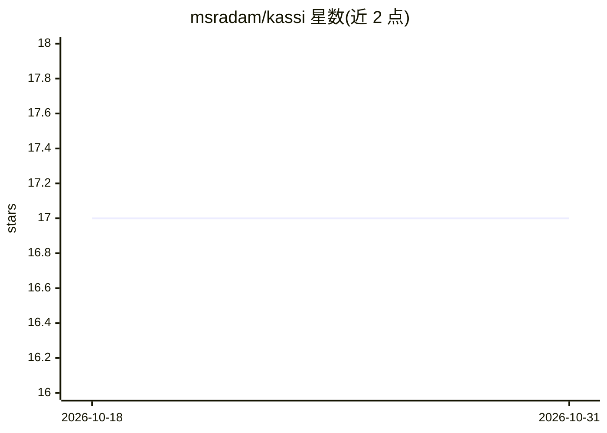

# msradam/kassi

⭐ 17 · Python · Apache-2.0 · 推送 2026-06-16 · [GitHub](https://github.com/msradam/kassi) · 个人维护

**AI agent：对代码改动做 k6 压测并在 Splunk 中定位回归与修复**

面向工程与 SRE 团队的 AI agent：读取 git diff 或自然语言意图，通过 Grafana k6 MCP 服务器生成并运行真实压测，经官方 Splunk MCP 服务器做窗口化 SPL 关联与异常检测，产出带引用的根因分析和可应用的修复 diff。整体运行为基于 Burr 的受治理状态机，非法步骤被拒绝，所有步骤与拒绝记录在哈希链账本上，可用 kassi verify 校验。模型后端无关，支持 Ollama 本地 8B 模型（默认 granite4.1:8b）或 Claude；Splunk 关联步骤可省略，退化为仅 k6 模式。为 Splunk Agentic Ops Hackathon 参赛项目。

## 筛选速览

| 维度 | 判定 | 备注 |
|---|---|---|
| AI 角色 | `ai-ecosystem` | LLM/agent 周边工具 |
| 许可风险 | `permissive` | Apache-2.0 |
| 部署形态 | `self-host` | docker 或自建部署 |
| 模型依赖 | local-ok | 支持本地模型 |
| 硬件要求 | — | 无带数字的原话,不猜 |
| 安装摩擦 | `low` | 无编译、无系统依赖或容器化 |
| 成熟度 | — | 结构信号不足 |

## 能力要点

- git diff 或自然语言意图驱动的 k6 压测生成与执行
- Splunk SPL 关联 + StateSpaceForecast/anomalydetection 定位饱和点
- 独立审计者模型核验分析声明后封存结论，哈希链账本可验证
- 模型后端无关：本地 Ollama 8B 到 Claude 均可驱动

## 适用场景

- 提交时自动压测变更端点，在上线前发现负载引发的回归
- 将压测结果与服务端遥测关联，定位零报错的延迟劣化根因
- 在隔离环境用本地模型执行带审计的压测分析流程

## 场景标签

 · 领域:开发运维/可观测性

## 证据(README 行号)

> L19: kassi runs as an audited Burr state machine over MCP, served by
> L51: - **Model-agnostic.** The same loop (drive, write, audit) runs on a local open 8B, on-prem and air-gapped, or on a 

## 星数曲线

2026-10-18 17 → 2026-10-31 17（+0）

---
*卡片 v1 · prompt 1.4 · 生成 2026-10-29 · 置信度 mid · 依据 README sha `bbd98d4baf4c` · [字段定义](../../DATASET.md)*
