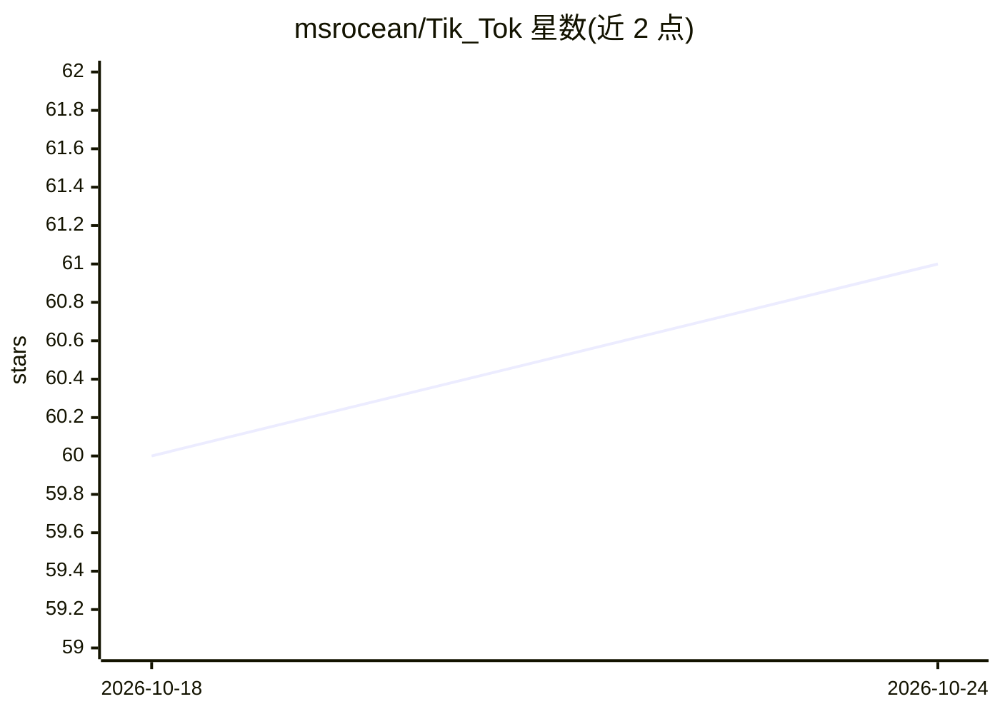

# msrocean/Tik_Tok

⭐ 61 · Python · MIT · 推送 2026-06-16 · [GitHub](https://github.com/msrocean/Tik_Tok) · 组织维护

**PETS 2020 论文代码与数据：用包定时特征做网站指纹攻击**

复现 PETS 2020 论文《Tik-Tok: The Utility of Packet Timing in Website Fingerprinting Attacks》的实验代码与数据集。面向 Tor 流量分析研究者，使用五种数据集（Undefended、WTF-PAD、Walkie-Talkie 模拟与真实、Onion Sites），将包定时、方向及组合表示为定长序列，输入 Deep Fingerprinting 等深度学习模型与传统 ML 分类器（k-NN、SVM/CUMUL、k-FP）进行网站识别实验，另含拥塞分析与信息泄露分析脚本。依赖 TensorFlow 1.14 与 CUDA 10.2，需 NVIDIA GPU，声明仅供研究用途。

## 筛选速览

| 维度 | 判定 | 备注 |
|---|---|---|
| AI 角色 | `ai-native` | 本体是模型或模型工具 |
| 许可风险 | `permissive` | MIT |
| 部署形态 | `library` | 以包/库形式分发 |
| 模型依赖 | — | README 未给出锁定关系 |
| 硬件要求 | — | 无带数字的原话,不猜 |
| 安装摩擦 | `medium` | 含编译或系统依赖之一 |
| 成熟度 | `idea` | |

## 能力要点

- 包定时/方向/方向定时四种数据表示（1x5000 序列或 160 维特征）
- 五种公开与自采数据集，含 2019 年收集的 Walkie-Talkie 真实数据集
- 提供闭开世界、拥塞分析、W-T 原型等复现实验脚本与 Jupyter notebook
- 数据集托管于 Zenodo，提供原始与预处理两种格式

## 适用场景

- 复现论文中包定时特征的网站指纹攻击实验
- 研究 Tor 流量防御（WTF-PAD、Walkie-Talkie）下的指纹攻击效果
- 分析快/慢电路拥塞对攻击准确率的影响

## 场景标签

`网络安全` · 领域:学习与行业

## 证据(README 行号)

> L5: This repository contains the code and data to demonstrate the ***Experiments*** and ***Reproduce*** the results of t
> L6: ### Tik-Tok: The Utility of Packet Timing in Website Fingerprinting Attacks (Read the Paper)
> L75: - NVIDIA GPU should be installed in the machine, running on CPU will significantly increase time complexity.

## 星数曲线

2026-10-18 60 → 2026-10-24 61（+1）

---
*卡片 v1 · prompt 1.4 · 生成 2026-10-24 · 置信度 high · 依据 README sha `4acc51775529` · [字段定义](../../DATASET.md)*
