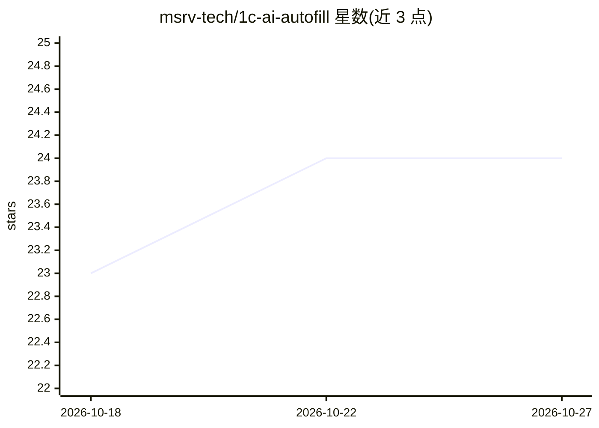

# msrv-tech/1c-ai-autofill

⭐ 24 · HTML · MIT · 推送 2026-05-29 · [GitHub](https://github.com/msrv-tech/1c-ai-autofill) · [官网](https://gitsell.ru/msrv-tech/1c-ai-autofill) · 组织维护

**面向 1C 用户的 AI 商品描述生成与自动填充扩展**

1С:Предприятие 8.3 扩展（.cfe，BSL），面向网店店主、商品目录与市场平台卖家：在商品卡片中一键根据商品名称生成商品描述，并可自动填充附加属性与特征。AI 调用通过 Gitsell 代理 API 完成，支持选择 Gemini、GigaChat、YandexGPT、OpenAI、Deepseek 等模型；需注册 Gitsell 获取 API key。适配 УНФ/Розница/УТ11/КА/ERP 配置，也可经 1С:Плюс 市场安装；提供 7 天免费试用期。

## 筛选速览

| 维度 | 判定 | 备注 |
|---|---|---|
| AI 角色 | `ai-native` | 本体是模型或模型工具 |
| 许可风险 | `permissive` | MIT |
| 部署形态 | `None` |  |
| 模型依赖 | — | README 未给出锁定关系 |
| 硬件要求 | — | 无带数字的原话,不猜 |
| 安装摩擦 | `low` | 无编译、无系统依赖或容器化 |
| 成熟度 | — | 结构信号不足 |

## 能力要点

- 从商品卡片一键生成商品描述（依据商品名称）
- 自动填充附加属性与特征
- 可选 Gemini/GigaChat/YandexGPT/OpenAI/Deepseek 等模型（经 Gitsell 代理 API）
- 适配 УНФ、Розница、УТ11、КА、ERP，经 1С:Плюс 市场安装并自动更新

## 适用场景

- 我在网店/市场平台卖货，想快速生成商品描述
- 我想自动填充商品的附加属性和特征，减少手工录入
- 我在 1С 中管理商品目录，希望用 AI 补全商品信息

## 场景标签

`AI 写作` · 领域:内容生成

## 证据(README 行号)

> L17: Расширение для **1С:Предприятие 8.3** (BSL) для автоматической генерации **продающих описаний товара** и автозаполн
> L23: Расширение создано для владельцев **интернет-магазинов**, каталогов товаров и продавцов на **маркетплейсах**. Одна 
> L57: * **"Заполнить ИИ"** — генерирует описание товара на основе наименования.

## 星数曲线

2026-10-18 23 → 2026-10-27 24（+1）

---
*卡片 v1 · prompt 1.4 · 生成 2026-10-27 · 置信度 high · 依据 README sha `88e8355d8734` · [字段定义](../../DATASET.md)*
