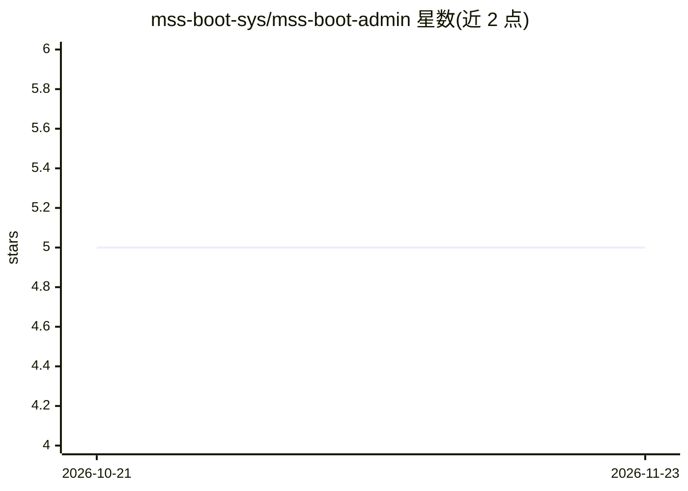

# mss-boot-sys/mss-boot-admin

⭐ 5 · Go · MIT · 推送 2026-11-20 · [GitHub](https://github.com/mss-boot-sys/mss-boot-admin) · [官网](docs.mss-boot-io.top Topics) · 组织维护

**给开发者提供 RBAC 与 API 注册的 Go 管理后台基础框架**

面向构建管理系统团队的 Go 后台基础框架，功能覆盖 RBAC 授权、API 注册、配置、i18n 与运维；采用 Thin Host 架构：生成的主机只持有组合代码与业务模块，导入完整的 Admin Go module 与 Admin Web 前端包，授权以后端为准。通过 mss CLI 创建、检查与升级应用，升级引擎只改动 Blueprint 管理的文件，要求提供 blueprint 清单。仓库同时维护供 AI Agent 读取的 AGENTS.md、.mss 与 skills 文档分层。

## 筛选速览

| 维度 | 判定 | 备注 |
|---|---|---|
| AI 角色 | `ai-enhanced` | 去掉 AI 部分产品仍成立 |
| 许可风险 | `permissive` | MIT |
| 部署形态 | `desktop` | 安装包/桌面程序 |
| 模型依赖 | — | README 未给出锁定关系 |
| 硬件要求 | — | 无带数字的原话,不猜 |
| 安装摩擦 | `low` | 无编译、无系统依赖或容器化 |
| 成熟度 | — | 结构信号不足 |

## 能力要点

- RBAC 授权、API 注册、配置与 i18n 能力
- Thin Host 架构：业务代码与框架核心分离，后端编译期注册
- mss CLI 提供 new/setup/dev/upgrade 与 doctor 检查
- 面向人类与 AI Agent 分层的文档体系（AGENTS.md/.mss/skills）

## 适用场景

- 搭建带权限管理的中后台系统
- 以代码生成与受控升级方式维护管理后台
- 为生成的管理后台配置 AI Agent 协作文档

## 场景标签

`代码生成` · 领域:编码与开发

## 证据(README 行号)

> L5: mss-boot is an agent-native management-system foundation. **v1.6.2 is the current
> L134: A generated application is a **Thin Host**. It imports the complete Admin Go
> L140: Runtime dynamic models, virtual CRUD, and browser-facing code generation remain

## 星数曲线

2026-10-21 5 → 2026-11-23 5（+0）

---
*卡片 v1 · prompt 1.4 · 生成 2026-11-21 · 置信度 high · 依据 README sha `379930e0555a` · [字段定义](../../DATASET.md)*
