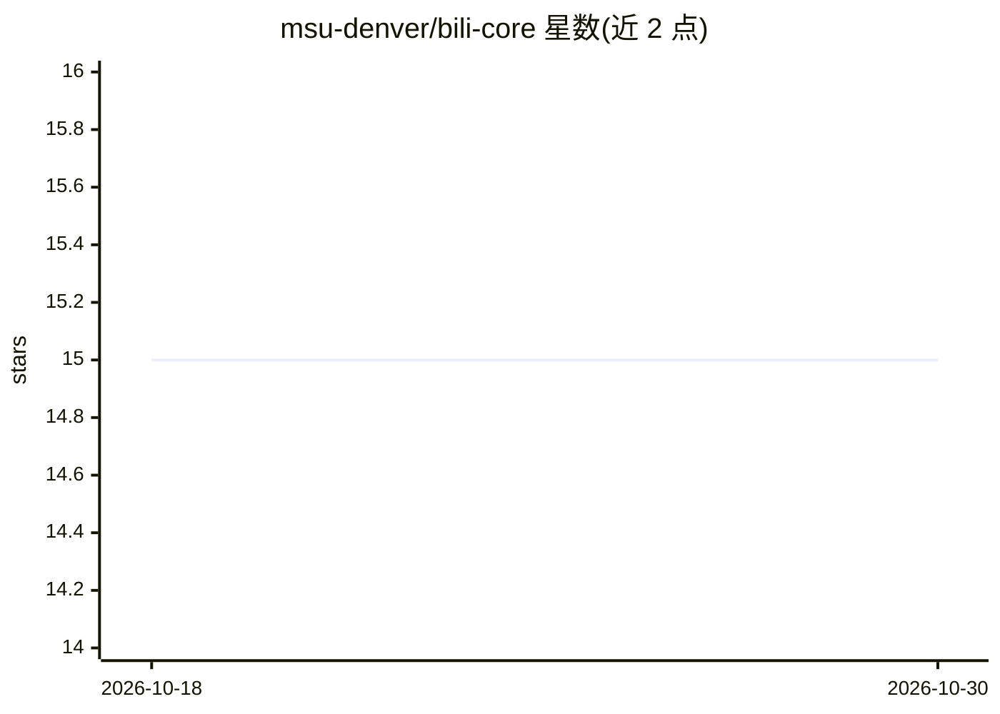

# msu-denver/bili-core

⭐ 15 · Python · MIT · 推送 2026-09-10 · [GitHub](https://github.com/msu-denver/bili-core) · [官网](https://c3-lab.org/) · 组织维护

**构建与测试 LLM 应用的框架：单智能体/多智能体编排+对抗安全测试**

MSU Denver C3 实验室开发、NSF 与 NAIRR Pilot 资助的开源 LLM 应用框架，含三个组件：IRIS 提供 118 种模型配置、18 类 provider 的单智能体节点式编排（含本地 Ollama/llama.cpp/HuggingFace 后端、结构化输出、工具调用与临时 MCP 服务器）；AETHER 用 YAML 声明多智能体系统并编译为 LangGraph 工作流，支持 7 种工作流类型与 6 种通信协议；AEGIS 基于 AETHER 做多智能体系统的对抗攻击注入与三层检测评测。开发环境以 Docker Compose 运行，附 Streamlit UI 与 Flask API。

## 筛选速览

| 维度 | 判定 | 备注 |
|---|---|---|
| AI 角色 | `ai-ecosystem` | LLM/agent 周边工具 |
| 许可风险 | `permissive` | MIT |
| 部署形态 | `self-host` | docker 或自建部署 |
| 模型依赖 | local-ok | 支持本地模型 |
| 硬件要求 | — | 无带数字的原话,不猜 |
| 安装摩擦 | `low` | 无编译、无系统依赖或容器化 |
| 成熟度 | — | 结构信号不足 |

## 能力要点

- IRIS 支持 118 种模型配置、18 类 provider（API/CLI/本地）
- AETHER 用 YAML 声明多智能体系统并编译为 LangGraph 工作流（7 种工作流类型、6 种通信协议）
- AEGIS 提供 7 类对抗测试套件与 3 层检测（结构/启发式/语义）
- 临时 MCP 服务器带 Bearer token 与进程归属双重校验

## 适用场景

- 编排带工具与记忆的单智能体 LLM 应用
- 用 YAML 定义并运行多智能体系统
- 对多智能体系统做提示注入、越狱等对抗安全测试
- 实验室多人通过 git worktree 并行开发测试

## 场景标签

`Agent 框架` `多智能体` `模型评测` `网络安全` · 领域:Agent 开发

## 证据(README 行号)

> L10: **BiliCore** is an open-source, domain-agnostic framework for building and testing LLM-powered applications. It pro
> L12: Originally developed for the **Colorado Sustainability Hub** at MSU Denver's **Community-Centered Computing (C3) La
> L54: AEGIS provides a systematic framework for testing how adversarial payloads propagate through multi-agent systems. I

## 星数曲线

2026-10-18 15 → 2026-10-30 15（+0）

---
*卡片 v1 · prompt 1.4 · 生成 2026-10-30 · 置信度 high · 依据 README sha `df6b4aac1991` · [字段定义](../../DATASET.md)*
