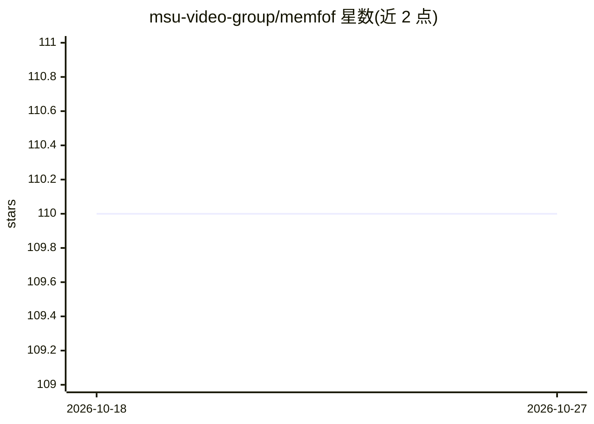

# msu-video-group/memfof

⭐ 110 · Python · BSD-3-Clause · 推送 2025-12-11 · [GitHub](https://github.com/msu-video-group/memfof) · [官网](https://msu-video-group.github.io/memfof/) · 组织维护

**面向 Full HD 视频的低显存多帧光流估计方法**

ICCV 2025 Highlight 论文的官方实现：多帧光流估计模型，针对 Full HD 视频在高分辨率训练下控制显存占用，提供 6 个预训练变体（Tartan/Tartan-T/TSKH 及针对 KITTI、Sintel、Spring 的版本）。可通过 pip 以 Python 库方式安装并计算前后向光流，另有 Colab 与在线 Demo。训练配置默认面向 4 节点×8 GPU，可用 slurm 或 torchrun 多节点训练，依赖 FlyingThings3D、Sintel、KITTI 等数据集。

## 筛选速览

| 维度 | 判定 | 备注 |
|---|---|---|
| AI 角色 | `ai-native` | 本体是模型或模型工具 |
| 许可风险 | `permissive` | BSD-3-Clause |
| 部署形态 | `library` | 以包/库形式分发 |
| 模型依赖 | — | README 未给出锁定关系 |
| 硬件要求 | — | 无带数字的原话,不猜 |
| 安装摩擦 | `low` | 无编译、无系统依赖或容器化 |
| 成熟度 | — | 结构信号不足 |

## 能力要点

- 针对 Full HD 视频的多帧光流估计，强调低显存占用
- 提供 6 个预训练模型变体（含针对 KITTI/Sintel/Spring 的版本）
- 支持 slurm / torchrun 多节点训练，可调梯度累积适应更少资源
- 提供 Colab 与 Hugging Face 在线 Demo

## 适用场景

- 给视频序列计算前后向光流
- 在 KITTI/Sintel/Spring 基准上评测或复现结果
- 用自有数据集训练光流模型

## 场景标签

 · 领域:计算机视觉/视频

## 证据(README 行号)

> L16: **MEMFOF** is a **memory-efficient optical flow method** for **Full HD video** that combines **high accuracy** with
> L20: Given a video sequence, our code can estimate its optical flow. Visit the demo page and try it with your own video.

## 星数曲线

2026-10-18 110 → 2026-10-27 110（+0）

---
*卡片 v1 · prompt 1.4 · 生成 2026-10-23 · 置信度 high · 依据 README sha `55a594b1073a` · [字段定义](../../DATASET.md)*
