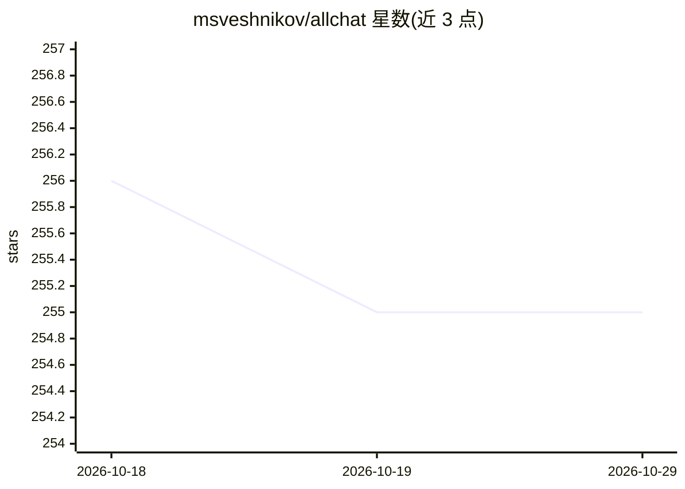

# msveshnikov/allchat

⭐ 255 · JavaScript · 推送 2026-10-11 · [GitHub](https://github.com/msveshnikov/allchat) · [官网](https://allchat.online) · 个人维护

**聚合多家大模型的 AI 聊天客户端应用**

自托管的 AI 助手应用，接入 Gemini Pro 1.5、Claude 3.5、GPT-4o 及 Together AI 开源模型（Mixtral、Llama-3 等），支持多会话历史、Artifacts、图像生成（SDXL）与识别、PDF/Word/Excel 上传、Python 代码执行、Web 工具（天气/股票/邮件/Telegram）、定时任务与共享聊天。运行需配置各家 API key 与本地 MongoDB，前后端通过 npm 安装并启动；另有在线版 allchat.online（含 4.99 美元订阅）。

## 筛选速览

| 维度 | 判定 | 备注 |
|---|---|---|
| AI 角色 | `ai-native` | 本体是模型或模型工具 |
| 许可风险 | `permissive` | — |
| 部署形态 | `self-host` | docker 或自建部署 |
| 模型依赖 | locked-api |  |
| 硬件要求 | — | 无带数字的原话,不猜 |
| 安装摩擦 | `low` | 无编译、无系统依赖或容器化 |
| 成熟度 | — | 结构信号不足 |

## 能力要点

- 接入 Gemini/Claude/GPT-4o/Together 等多家模型
- Python 代码执行与 Web 工具（天气、股票、邮件、Telegram、搜索）
- 图像生成（SDXL）与图像/PDF/Word/Excel 输入
- 定时任务、共享聊天、Artifacts、PWA 与 Android 应用

## 适用场景

- 在一个应用中使用多家大模型进行日常对话
- 让 AI 执行 Python 代码并获取文件/PPT 产出
- 定时生成内容并发送邮件或 Telegram 通知

## 场景标签

`AI 助手` `图像生成` · 领域:对话与助手

## 证据(README 行号)

> L3: An AI assistant app that interacts with all major models, maintains history, generates and recognizes images, upload
> L20: - Gemini Pro 1.5, Claude 3.5 and GPT-4o

## 星数曲线

2026-10-18 256 → 2026-10-29 255（-1）

---
*卡片 v1 · prompt 1.4 · 生成 2026-10-22 · 置信度 mid · 依据 README sha `645ddb23e802` · [字段定义](../../DATASET.md)*
