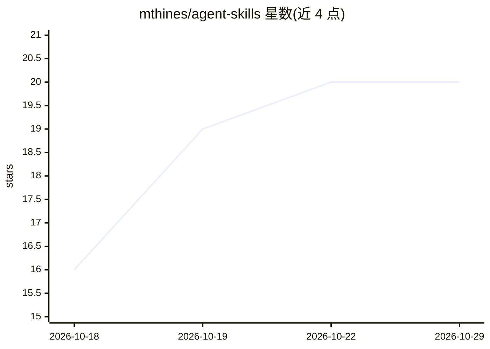

# mthines/agent-skills

⭐ 20 · JavaScript · MIT · 推送 2026-10-28 · [GitHub](https://github.com/mthines/agent-skills) · 个人维护

**个人维护的 AI 编程助手技能集：工作流、评审与调试技能**

面向使用编码 agent 的开发者的技能（Skills）集合，按 workflow/quality/delivery/testing/design/analysis/authoring 七类组织，覆盖端到端自主工作流 aw（任务定级→简报→构建到检查通过→新鲜视角评审→草稿 PR）、bug 定位修复、PR 评审循环、UI 与遥测验证、UX/视觉审计等。技能通过 git clone 加 symlink 脚本或 npx skills add 安装到 Claude Code、Cursor、Codex、Copilot 等兼容工具；作者以有无技能的对比评估决定去留，README 载明删减了 400KB 以上提示词。MIT 许可。

## 筛选速览

| 维度 | 判定 | 备注 |
|---|---|---|
| AI 角色 | `ai-knowledge` | 知识聚合/清单类 |
| 许可风险 | `permissive` | MIT |
| 部署形态 | `library` | 以包/库形式分发 |
| 模型依赖 | — | README 未给出锁定关系 |
| 硬件要求 | — | 无带数字的原话,不猜 |
| 安装摩擦 | `low` | 无编译、无系统依赖或容器化 |
| 成熟度 | — | 结构信号不足 |

## 能力要点

- aw 自主工作流：一句话任务到经评审的草稿 PR
- 技能以有无自身的对比评估筛选，未改变结果的被删除
- 安装为 symlink 活链接，git pull 即完成升级
- 兼容 Claude Code、Cursor、Codex、Gemini CLI 等多种工具

## 适用场景

- 让编码 agent 端到端完成从任务到 PR 的工作流
- 为 PR 增加独立评审与验证循环
- 对 UI 变更做浏览器与遥测层面的验证

## 场景标签

`提示工程` · 领域:Agent 开发

## 证据(README 行号)

> L11: These skills encode how I build software with agents: scope the task, build against checks, get a second pair of ey
> L13: They install into Claude Code, Cursor, Codex, Gemini CLI, Copilot, Windsurf, OpenCode, and any other Agent Skills-c

## 星数曲线

2026-10-18 16 → 2026-10-29 20（+4）

---
*卡片 v1 · prompt 1.4 · 生成 2026-10-28 · 置信度 high · 依据 README sha `2fda33393395` · [字段定义](../../DATASET.md)*
