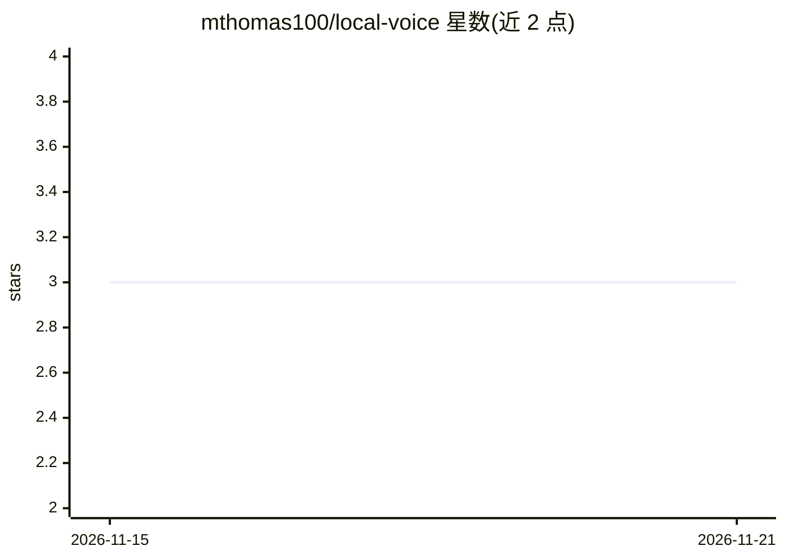

# mthomas100/local-voice

⭐ 3 · Python · MIT · 推送 2026-10-12 · [GitHub](https://github.com/mthomas100/local-voice) · 个人维护

**Apple silicon 上的全本地语音助手：说话即回应**

在 Apple silicon Mac 上全本地运行的语音代理：Pipecat 管线处理语音，Silero VAD 与 Smart Turn 判定话轮结束，流式 Nemotron/Parakeet ASR 转写，Qwen3-TTS/Kokoro 合成回复，LLM 经 Pi 在本地生成答案。通过 spaces 机制以编码代理操作 Mac 文件与工具，写入需语音确认（approval 卡片）。提供 SwiftUI iPhone 应用与 Mac 菜单栏应用，经 WebSocket 连接服务器。为两日内完成的原型，README 声明仍有未解决问题；实测暖启动首音频中位 874 ms，冷启动 3.9 s。

## 筛选速览

| 维度 | 判定 | 备注 |
|---|---|---|
| AI 角色 | `ai-native` | 本体是模型或模型工具 |
| 许可风险 | `permissive` | MIT |
| 部署形态 | `None` |  |
| 模型依赖 | — | README 未给出锁定关系 |
| 硬件要求 | — | 无带数字的原话,不猜 |
| 安装摩擦 | `low` | 无编译、无系统依赖或容器化 |
| 成熟度 | `idea` | |

## 能力要点

- 全本地管线：ASR、LLM、TTS 均在 Mac 上运行，实测首音频中位 874 ms
- Barge-in：约 70 ms 内暂停回复音频，Silero 确认后中断
- Spaces 机制：每个空间独立的 Pi 子进程、工具白名单与风险分级（readonly/ask/trusted）
- 写入/编辑/命令执行前语音询问并出示 approval 卡片

## 适用场景

- 在 Mac 上进行无需云端的语音对话
- 用语音让代理在指定目录内执行文件操作并逐次确认
- iPhone 经 Tailscale 远程连接 Mac 语音服务

## 场景标签

`语音 Agent` · 领域:对话与助手

## 证据(README 行号)

> L11: **A fully local voice agent for Apple silicon.** You talk and it talks back, fast enough to feel like a conversatio
> L13: as your home folder, a journal or a knowledge base. Everything runs on the Mac. A Pipecat
> L22: > Status: a working prototype built in about two days (2026-10-04/05), much of it by coding agents working in paral

## 星数曲线

2026-11-15 3 → 2026-11-21 3（+0）

---
*卡片 v1 · prompt 1.4 · 生成 2026-11-21 · 置信度 high · 依据 README sha `ec079cb802f6` · [字段定义](../../DATASET.md)*
