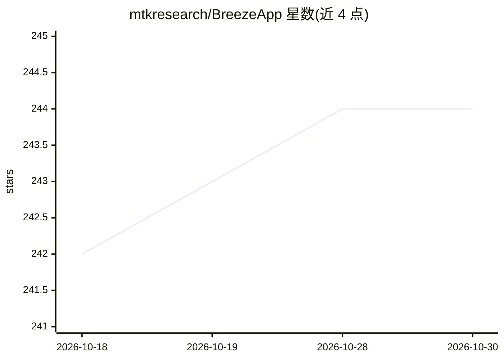

# mtkresearch/BreezeApp

⭐ 244 · Kotlin · Apache-2.0 · 推送 2026-01-23 · [GitHub](https://github.com/mtkresearch/BreezeApp) · 组织维护 · 中文 README

**手機端離線運行 LLM/VLM/ASR/TTS 的純手機 AI 應用**

MediaTek Research 開源的 Android/iOS 純手機 AI 應用，v2 採用 Git Submodules 模組化架構：BreezeApp-engine 推理引擎、BreezeApp-client 工程示範 App、正式消費版 App 尚未發布。功能含文字聊天、語音輸入輸出、圖像問答，全部離線運行（支援飛航模式）。預設搭載 Breeze 2 系列模型，提供更換 Llama 3.2 後端的說明；支援 CPU 與 MediaTek NPU 後端（NPU 尚未覆蓋 VLM/ASR/TTS）。程式碼由 Java 遷移至 Kotlin 並提供 EdgeAI SDK 標準化 API。

## 筛选速览

| 维度 | 判定 | 备注 |
|---|---|---|
| AI 角色 | `ai-native` | 本体是模型或模型工具 |
| 许可风险 | `permissive` | Apache-2.0 |
| 部署形态 | `None` |  |
| 模型依赖 | — | README 未给出锁定关系 |
| 硬件要求 | — | 无带数字的原话,不猜 |
| 安装摩擦 | `low` | 无编译、无系统依赖或容器化 |
| 成熟度 | `idea` | |

## 能力要点

- 文字聊天/語音/圖像問答全部離線運行，支援飛航模式
- 預設 Breeze 2 模型，可更換 Llama 3.2 後端
- CPU 與 MediaTek NPU 雙後端
- EdgeAI SDK 提供聊天/語音/視覺標準化 API

## 适用场景

- 在手機上離線使用 LLM 聊天與語音功能，資料不離開裝置
- 下載 APK 體驗純手機端 AI 應用
- 開發者基於 Kotlin 開源碼與 EdgeAI SDK 打造自己的手機 AI 應用

## 场景标签

`多模态` `AI 助手` · 领域:对话与助手

## 证据(README 行号)

> L37: BreezeAPP is a mobile AI application developed for both Android and iOS platforms. Users can download it directly f
> L99: - 👁️ **Vision**: Image understanding and Q&A

## 星数曲线

2026-10-18 242 → 2026-10-30 244（+2）

---
*卡片 v1 · prompt 1.4 · 生成 2026-10-22 · 置信度 high · 依据 README sha `8a57f60fe034` · [字段定义](../../DATASET.md)*
