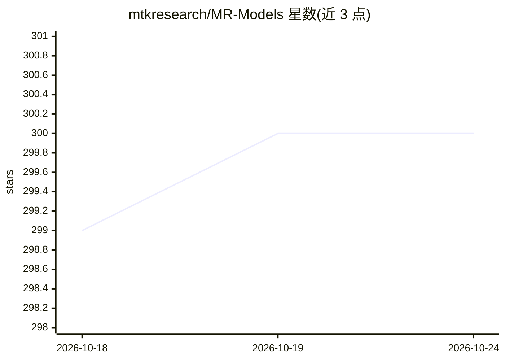

# mtkresearch/MR-Models

⭐ 300 · NOASSERTION · 推送 2026-04-23 · [GitHub](https://github.com/mtkresearch/MR-Models) · 组织维护 · 中文 README

**联发创新基地的繁体中文基础模型家族（Breeze 系列）**

MediaTek Research 发布的面向繁体中文使用者的开源模型集合：包括 Breeze 2 多模态语言模型（3B/8B，基于 LLaMA 3.2，含视觉编码器与函数调用）及语音合成模型（支持声音复制）、Breexe-8x7B（基于 Mixtral-8x7B）、Breeze-7B（基于 Mistral-7B，扩展 3 万繁体词表）、Breeze-ASR 语音识别及 Bloom-zh 系列等，多以 Hugging Face Collection 形式提供权重并附论文，另提供 mtkresearch PyPI 使用套件与 TC-Eval 繁中评测集。

## 筛选速览

| 维度 | 判定 | 备注 |
|---|---|---|
| AI 角色 | `ai-native` | 本体是模型或模型工具 |
| 许可风险 | `none` | NOASSERTION |
| 部署形态 | `library` | 以包/库形式分发 |
| 模型依赖 | — | README 未给出锁定关系 |
| 硬件要求 | — | 无带数字的原话,不猜 |
| 安装摩擦 | `low` | 无编译、无系统依赖或容器化 |
| 成熟度 | — | 结构信号不足 |

## 能力要点

- Breeze 2 多模态模型（3B/8B）支持视觉感知与函数调用
- 语音合成模型支持繁中/英文/注音输入与声音复制
- Breeze-7B/Breexe 扩展 30,000 繁体中文词表
- 提供 mtkresearch PyPI 套件与 TC-Eval 繁中评测集

## 适用场景

- 繁体中文场景下部署问答、RAG、多轮对话与摘要
- 需要繁中文化语境的多模态视觉理解任务
- 繁体中文语音合成与语音识别应用开发

## 场景标签

`语音合成` `语音识别` `多模态` · 领域:内容生成

## 证据(README 行号)

> L41: Breeze 2 是一套先進的多模態模型家族。包含多模態語言模型以及語音合成模型。多模態語言模型提供 3B 和 8B 參數配置，專為加強繁體中文語言表示而設計。在 LLaMA 3.2 的基礎上，Breeze 2 持續在大規模語料庫
> L51: Breexe-8x7B 是一個語言模型家族，基於 Mixtral-8x7B 開發，專門針對繁體中文使用。

## 星数曲线

2026-10-18 299 → 2026-10-24 300（+1）

---
*卡片 v1 · prompt 1.4 · 生成 2026-10-22 · 置信度 high · 依据 README sha `2d692948b4ba` · [字段定义](../../DATASET.md)*
