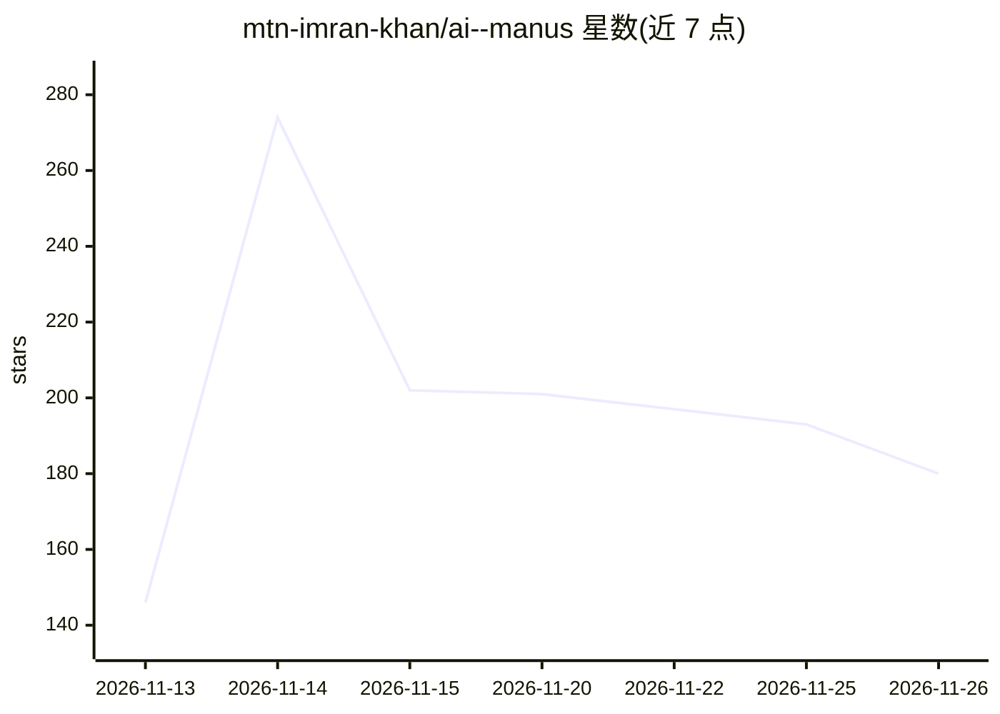

# mtn-imran-khan/ai--manus

⭐ 180 · Apache-2.0 · 推送 2026-11-13 · [GitHub](https://github.com/mtn-imran-khan/ai--manus) · 个人维护

**面向个人用户的自主 AI Agent：代跑代码与操控浏览器**

Manus 是一个自主 AI Agent 项目，README 描述其可代替用户执行代码、编写并运行脚本、操控浏览器（导航网页、填表、采集信息），完成多步骤任务。定位为家庭、学习与轻量办公场景的个人助手，明确声明不是重型工作室套件或企业平台。给出兼容性表（最低双核 CPU、4 GB 内存）与上手流程（准备、配置、测试、细化、应用、维护六个步骤）。README 未提供具体的安装命令、技术架构或模型接入方式，仅列出相关搜索词。

## 筛选速览

| 维度 | 判定 | 备注 |
|---|---|---|
| AI 角色 | `ai-native` | 本体是模型或模型工具 |
| 许可风险 | `permissive` | Apache-2.0 |
| 部署形态 | `None` |  |
| 模型依赖 | — | README 未给出锁定关系 |
| 硬件要求 | — | 无带数字的原话,不猜 |
| 安装摩擦 | `low` | 无编译、无系统依赖或容器化 |
| 成熟度 | — | 结构信号不足 |

## 能力要点

- 自主执行代码与脚本运行
- 浏览器控制：导航网页、填写表单、采集信息
- 面向学习、家庭项目与轻量办公的多步骤任务自动化
- 兼容性表：最低 4 GB 内存、双核 CPU

## 适用场景

- 让代理代替我跑小脚本和快速实验
- 自动浏览多个网页并汇总信息
- 处理整理文件、查资料等重复性日常小任务

## 场景标签

`AI 助手` `浏览器自动化` `编码 Agent` · 领域:效率与自动化

## 证据(README 行号)

> L10: - **Autonomous Code Execution:** Manus AI agent runs code on its own to complete tasks, so you can focus on decisio
> L18: Manus is an autonomous AI agent designed to run code and control a browser on your behalf. Instead of acting like a

## 星数曲线

2026-11-13 146 → 2026-11-26 180（+34）

---
*卡片 v1 · prompt 1.4 · 生成 2026-11-17 · 置信度 low · 依据 README sha `66ba5de9af15` · [字段定义](../../DATASET.md)*
