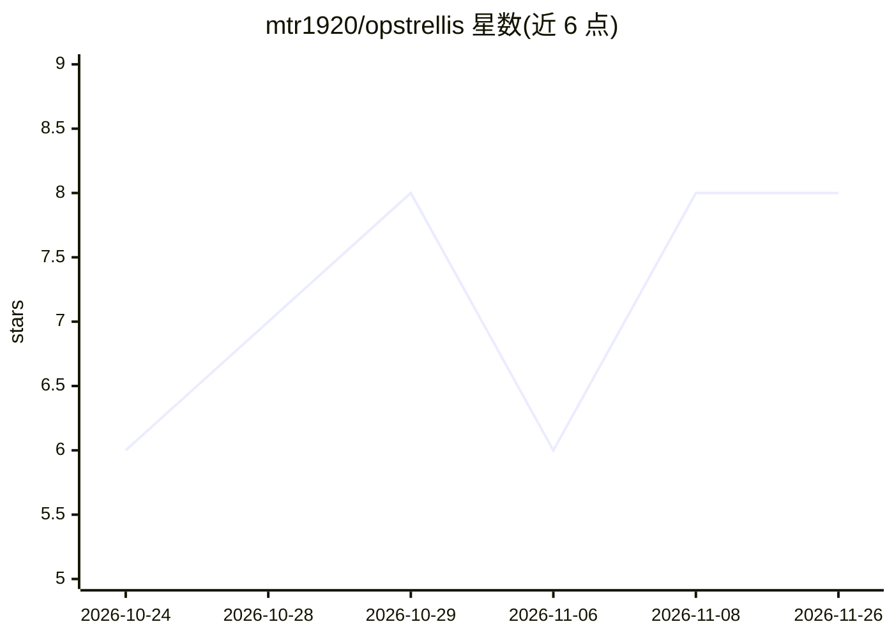

# mtr1920/opstrellis

⭐ 8 · Rust · MIT · 推送 2026-11-13 · [GitHub](https://github.com/mtr1920/opstrellis) · [官网](https://mtr1920.github.io/opstrellis/) · 个人维护

**macOS/Linux 按键说话的离线语音输入工具，任意应用出文本**

桌面端语音听写应用：按住快捷键说话，松开后经过清理的文本插入当前应用。默认离线转写（引导安装约 100 MB 的 Moonshine Tiny 本地模型），云转写服务可选并使用用户自己的 key。提供填充词移除、语音命令、词典与术语包、代码标识符纠正、可选 AI 润色（支持 OpenAI 兼容端点、Anthropic 或本地 llama.cpp 模型）、命令模式改写、片段扩展与可搜索历史。MIT 许可，通过安装脚本或 .dmg/.deb/AppImage 分发。

## 筛选速览

| 维度 | 判定 | 备注 |
|---|---|---|
| AI 角色 | `ai-native` | 本体是模型或模型工具 |
| 许可风险 | `permissive` | MIT |
| 部署形态 | `desktop` | 安装包/桌面程序 |
| 模型依赖 | — | README 未给出锁定关系 |
| 硬件要求 | — | 无带数字的原话,不猜 |
| 安装摩擦 | `low` | 无编译、无系统依赖或容器化 |
| 成熟度 | — | 结构信号不足 |

## 能力要点

- 系统级按键说话听写，任意应用内插入清理后的文本
- 默认离线转写与可选的本地 llama.cpp 润色模型
- 开发者术语包约 330 条，含 kubectl 等常见误听纠正
- 词典/片段/自动学习纠错与按应用区分的文风设置

## 适用场景

- 在编辑器和终端里口述代码标识符与路径
- 不用手打键盘向 ChatGPT/Claude 等口述长提示词
- 离线环境下做隐私优先的语音输入
- 给聊天与邮件写文本时口述并按场景调整语气

## 场景标签

`语音识别` · 领域:感知与多模态

## 证据(README 行号)

> L5:  Voice dictation for macOS and Linux.
> L25: - **Private by default:** transcribes offline on your computer out of the box. Cloud providers
> L142: |Real-time|Streams audio to Deepgram, AssemblyAI or OpenAI Realtime while you speak, with live text in the pill. L

## 星数曲线

2026-10-24 6 → 2026-11-26 8（+2）

---
*卡片 v1 · prompt 1.4 · 生成 2026-11-20 · 置信度 mid · 依据 README sha `cac0f717f622` · [字段定义](../../DATASET.md)*
