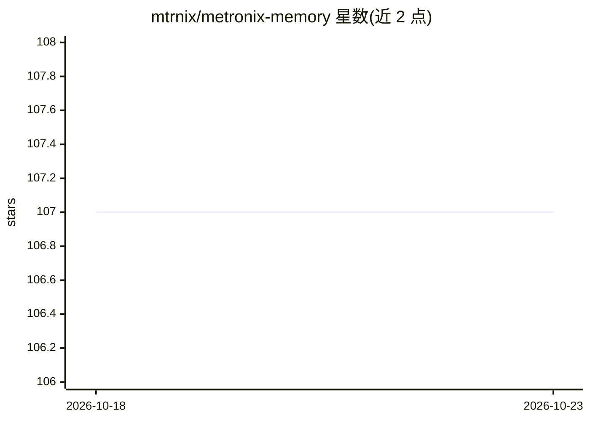

# mtrnix/metronix-memory

⭐ 107 · Python · Apache-2.0 · 推送 2026-10-20 · [GitHub](https://github.com/mtrnix/metronix-memory) · [官网](https://mtrnix.com) · 组织维护

**自托管的 AI agent 记忆服务器：MCP 接入、混合检索、持久记忆**

面向 AI agent 的自托管记忆基础设施：以 MCP memory server 为主要接入面（另有 REST 与 OpenAI 兼容 API），按 workspace 与 agent_id 分域存储事实、偏好与置顶上下文。检索采用 dense + SPLADE 稀疏 + Neo4j 图上下文的混合方式，并带来源引用；内置数据新鲜度检测（识别过期或冲突记忆）。通过 Docker Compose 部署，捆绑本地模型，可选外部答案生成；要求 Docker 环境 ≥6 GB RAM 与约 15 GB 磁盘。README 附有 LoCoMo/LongMemEval-S 等基准的方向性结果（多为 N=1 或外部未复现，作者明确声明非 SOTA 声称）。

## 筛选速览

| 维度 | 判定 | 备注 |
|---|---|---|
| AI 角色 | `ai-ecosystem` | LLM/agent 周边工具 |
| 许可风险 | `permissive` | Apache-2.0 |
| 部署形态 | `self-host` | docker 或自建部署 |
| 模型依赖 | — | README 未给出锁定关系 |
| 硬件要求 | — | 无带数字的原话,不猜 |
| 安装摩擦 | `low` | 无编译、无系统依赖或容器化 |
| 成熟度 | — | 结构信号不足 |

## 能力要点

- MCP memory server 接入面，附带 REST 与 OpenAI 兼容 API
- dense + SPLADE 稀疏 + Neo4j 图上下文的混合检索，带来源引用
- 按 workspace 与 agent_id 分域的持久记忆与新鲜度/冲突检测
- Docker Compose 一键部署，捆绑本地模型

## 适用场景

- 让 AI agent 跨会话持久记住事实与用户偏好
- 为团队构建自托管、数据可控的 agent 知识/记忆后端
- 通过 MCP 给 Cursor、Claude Code 等客户端挂载长期记忆

## 场景标签

`Agent 记忆` · 领域:Agent 开发

## 证据(README 行号)

> L5: **Self-hosted AI agent memory — an MCP memory server with durable recall, hybrid RAG, and Neo4j graph context.**
> L7: Metronix is self-hosted memory infrastructure for AI agents: ingest files and SaaS knowledge, retrieve with dense + 
> L19: - **One integration surface** — MCP memory server today; REST and OpenAI-compatible APIs when you need them

## 星数曲线

2026-10-18 107 → 2026-10-23 107（+0）

---
*卡片 v1 · prompt 1.4 · 生成 2026-10-23 · 置信度 high · 依据 README sha `9759074a0bf4` · [字段定义](../../DATASET.md)*
