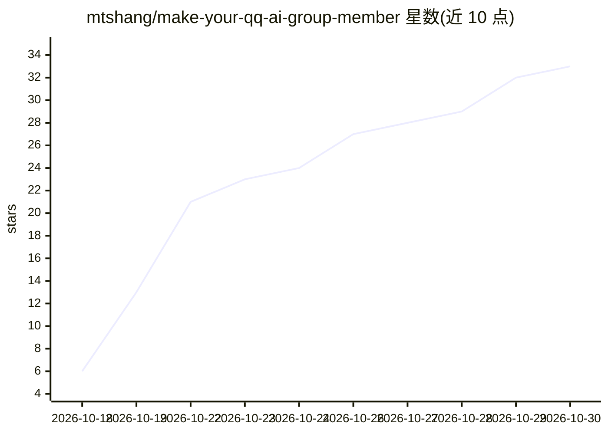

# mtshang/make-your-qq-ai-group-member

⭐ 33 · Python · MIT · 推送 2026-10-12 · [GitHub](https://github.com/mtshang/make-your-qq-ai-group-member) · 个人维护 · 中文 README

**一键部署 QQ AI 群友的 Agent Skill 部署编排包**

面向支持 Skill 的 AI Agent（WorkBuddy、Claude Code 等）的部署编排技能包：Agent 读取 SKILL.md 后自动完成 AstrBot（LLM 管家）+ NapCatQQ（QQ 协议端）+ 读空气插件的下载、配置、启动与扫码，交付一个可在 QQ 群聊自然接话的机器人，具备人设卡、识图、时段/情绪/疲劳等拟人化机制。用户只需提供 QQ 小号与大模型 API key，部署约 10~20 分钟；不修改上游代码，仅做编排，使用非官方协议端存在账号风控风险。

## 筛选速览

| 维度 | 判定 | 备注 |
|---|---|---|
| AI 角色 | `ai-ecosystem` | LLM/agent 周边工具 |
| 许可风险 | `permissive` | MIT |
| 部署形态 | `None` |  |
| 模型依赖 | — | README 未给出锁定关系 |
| 硬件要求 | — | 无带数字的原话,不猜 |
| 安装摩擦 | `low` | 无编译、无系统依赖或容器化 |
| 成熟度 | — | 结构信号不足 |

## 能力要点

- AstrBot + NapCatQQ + 读空气插件的全自动部署编排
- 预置人格卡与消息质量打分、疲劳系统等拟人化机制
- 国内镜像轮换下载与七项全链路验收清单
- SKILL.md 含 Phase 0-8 流程、30 条踩坑记录，人类也可直接阅读

## 适用场景

- 让 Agent 自动部署一个会读空气的 QQ 群聊机器人
- 零 Git 基础用户通过对话式指令完成全部配置
- 用小号低成本试玩有'人设'的 AI 群友

## 场景标签

`聊天机器人` · 领域:对话与助手

## 证据(README 行号)

> L5: 这是一个 **Agent Skill**（智能体技能包）：把它喂给任意支持 Skill 的 AI Agent（WorkBuddy、Claude Code 等），Agent 会按 `SKILL.md` 里的流程自动完成全部部署——下载
> L33: - 🧩 **拼装开源组件**：AstrBot（LLM 管家）+ NapCatQQ（QQ 协议端）+ astrbot_plugin_group_chat_plus（读空气插件），本 skill 不修改任何上游代码，只做部署编排

## 星数曲线

2026-10-18 6 → 2026-10-30 33（+27）

---
*卡片 v1 · prompt 1.4 · 生成 2026-10-26 · 置信度 high · 依据 README sha `a6f7d1f70171` · [字段定义](../../DATASET.md)*
