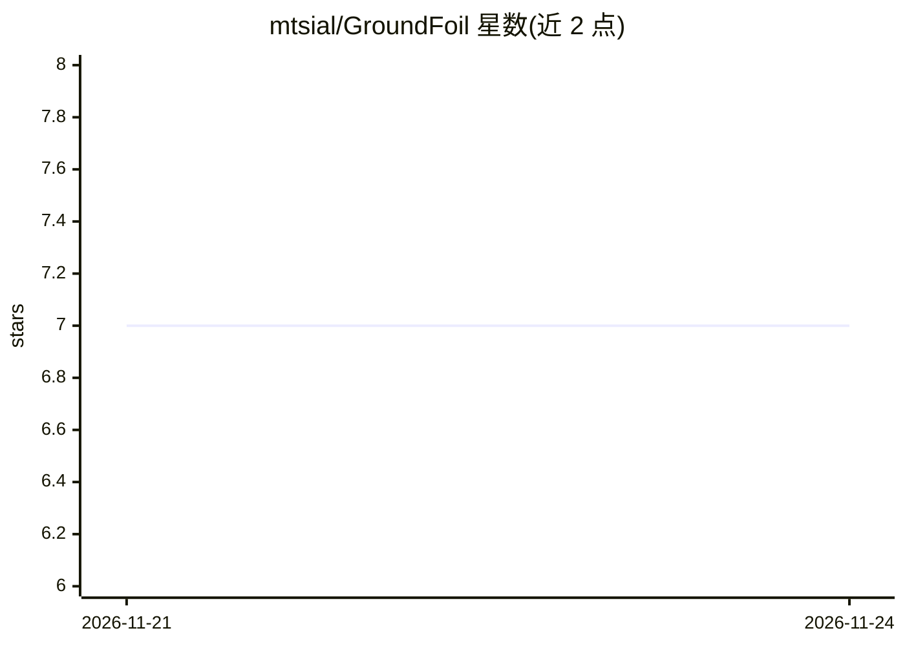

# mtsial/GroundFoil

⭐ 7 · Python · Apache-2.0 · 推送 2026-11-23 · [GitHub](https://github.com/mtsial/GroundFoil) · 个人维护

**面向 F1 翼型地效流动预测的深度学习代理模型与数据集**

基于自建 RANS（OpenFOAM）仿真的研究型项目，训练 U-Net 预测倒置翼型在地面效应下的压力与速度场（F1 前翼场景），复现 Thuerey et al. (2020) 并扩展到地效设置。提供六步工作流文档、6,177 样本数据集、训练好的模型与小型网络（仅输出下压力/表面压力）。运行依赖 Docker 容器内的 OpenFOAM v2606 与 gmsh，数据与模型发布在 Zenodo。面向 CFD/深度学习研究者，结果尚未伴随论文发表。

## 筛选速览

| 维度 | 判定 | 备注 |
|---|---|---|
| AI 角色 | `ai-native` | 本体是模型或模型工具 |
| 许可风险 | `permissive` | Apache-2.0 |
| 部署形态 | `self-host` | docker 或自建部署 |
| 模型依赖 | — | README 未给出锁定关系 |
| 硬件要求 | — | 无带数字的原话,不猜 |
| 安装摩擦 | `low` | 无编译、无系统依赖或容器化 |
| 成熟度 | — | 结构信号不足 |

## 能力要点

- U-Net 在 28 个未见翼型上场误差 0.8%、下压力误差 3.3%（自述）
- CFD 结果经 LES、风洞实验（Tyrrell 026）与网格收敛性检验校验
- 6,177 条地效 RANS 仿真数据集与训练模型发布于 Zenodo
- 附带仅预测下压力的小型网络（约 0.65 ms/预测）与表面压力网络

## 适用场景

- 研究翼型地面效应下流动场的快速替代预测
- 复现并在新软件栈上运行 Thuerey 2020 翼型流动深度学习流程
- 获取地面效应 RANS 数据集用于训练或验证代理模型
- 在 F1 前翼设计语境下估算下压力随高度的曲线

## 场景标签

 · 领域:科研/流体力学与深度学习

## 证据(README 行号)

> L6: **GroundFoil** predicts the flow around **inverted airfoils in ground effect**
> L15: Trained on 6,177 of these simulations, the U-Net predicts the flow around 28
> L145: You need Docker Desktop: OpenFOAM runs inside the container. In this folder,

## 星数曲线

2026-11-21 7 → 2026-11-24 7（+0）

---
*卡片 v1 · prompt 1.4 · 生成 2026-11-22 · 置信度 high · 依据 README sha `f95ce6b989cd` · [字段定义](../../DATASET.md)*
