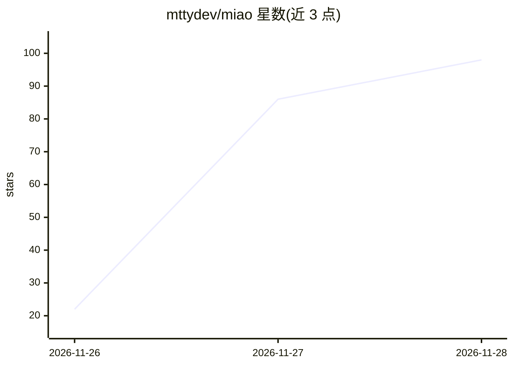

# mttydev/miao

⭐ 98 · TypeScript · MIT · 推送 2026-11-27 · [GitHub](https://github.com/mttydev/miao) · [官网](https://mtty.dev/miao) · 个人维护 · 中文 README

**在终端与你协作的开源 AI 编码代理，自带模型选择与成本可见**

用 Rust 与 TypeScript 实现的终端 AI agent：在所选模型上执行写代码、检索、文件管理与任务自动化，提供多 provider 切换、子 agent 会话、持久化会话历史（列出/重开/fork/导出）、任务中途插话排队、按轮次的用量与费用遥测、上下文压缩与预算控制。支持 MCP 服务器、LSP 诊断、HTTP server 与浏览器界面；可嵌入 mtty 终端获得面板状态通知。当前为 pre-1.0，Windows 二进制未签名，自动续跑循环需显式开启。

## 筛选速览

| 维度 | 判定 | 备注 |
|---|---|---|
| AI 角色 | `ai-native` | 本体是模型或模型工具 |
| 许可风险 | `permissive` | MIT |
| 部署形态 | `None` |  |
| 模型依赖 | — | README 未给出锁定关系 |
| 硬件要求 | — | 无带数字的原话,不猜 |
| 安装摩擦 | `low` | 无编译、无系统依赖或容器化 |
| 成熟度 | `idea` | |

## 能力要点

- 单界面使用多个 provider，会话内切换模型并可为子 agent 配置独立模型与权限
- 持久化会话：列出、重开、fork 与导出，事件化历史
- 按轮次 token 用量、估算费用、首 token 时间与 prompt-cache 遥测
- 本地/远程 MCP 服务器、自定义命令、skills 与插件接入

## 适用场景

- 在终端里让 agent 定位并修复失败的测试，同时追加 API 兼容约束
- 比较不同模型在同一工程任务下的表现而不更换工具链
- 长任务中给运行中的 agent 补充需求而不打断当前工作
- 通过 MCP 与自定义命令把自有工具接进 agent 工作流

## 场景标签

`编码 Agent` · 领域:编码与开发

## 证据(README 行号)

> L9: **miao is an open-source AI agent that works with you in the terminal.** Use the models you choose to write code, re
> L35: Use multiple providers in one interface, switch models within a session, and configure specialist agents with their

## 星数曲线

2026-11-26 22 → 2026-11-28 98（+76）

---
*卡片 v1 · prompt 1.4 · 生成 2026-11-26 · 置信度 high · 依据 README sha `1b7215a325b4` · [字段定义](../../DATASET.md)*
