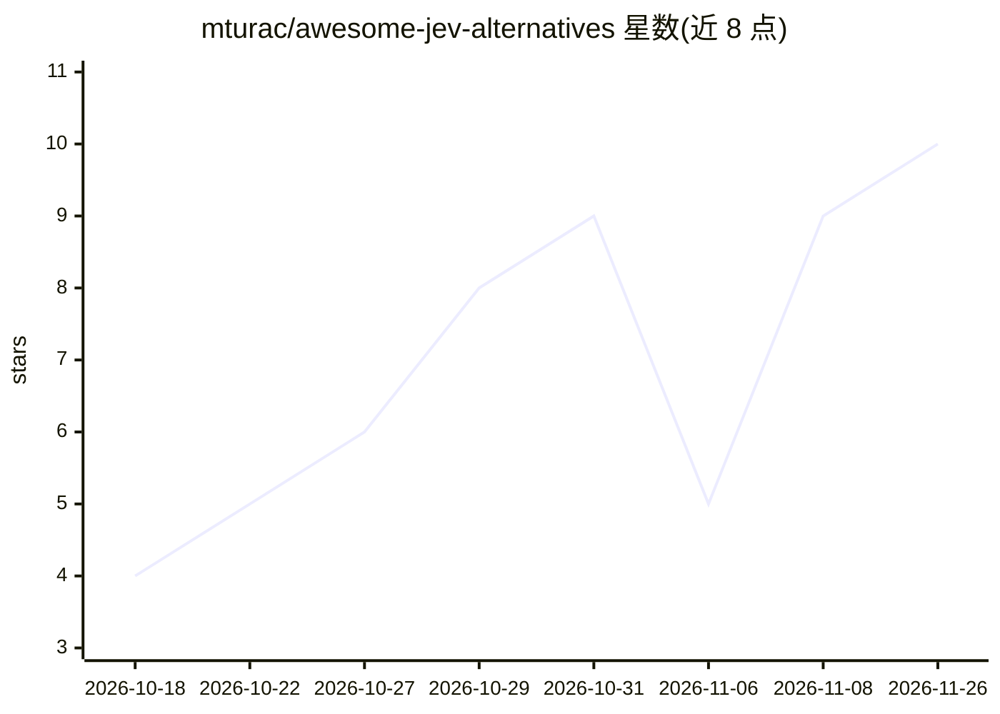

# mturac/awesome-jev-alternatives

⭐ 10 · Python · CC0-1.0 · 推送 2026-09-27 · [GitHub](https://github.com/mturac/awesome-jev-alternatives) · 个人维护

**为需要开源替代方案的开发者提供 Jev 式决策模型的开源组件清单**

一份经过核验的策展清单，收录 System One 风格决策模型（Jev）的开源替代与组件，按决策引擎、运行时与移植、零样本分类器、校准、基准与数据集、研究论文分区组织。收录方式为逐条抓取链接并通过 GitHub API 读取星标、许可证标识与最近推送时间，剔除已归档或 365 天无推送的仓库（除非标注 historical）；条目描述以指出局限为主。清单本身不含可运行代码，收录对象涵盖模型、服务器、数据集与论文。

## 筛选速览

| 维度 | 判定 | 备注 |
|---|---|---|
| AI 角色 | `ai-knowledge` | 知识聚合/清单类 |
| 许可风险 | `viral` | CC0-1.0 |
| 部署形态 | `None` |  |
| 模型依赖 | — | README 未给出锁定关系 |
| 硬件要求 | — | 无带数字的原话,不猜 |
| 安装摩擦 | `medium` | 含编译或系统依赖之一 |
| 成熟度 | — | 结构信号不足 |

## 能力要点

- 逐条经 GitHub API 核验星标、许可证与最近推送，剔除归档仓库
- 按决策引擎/运行时/校准/数据集/论文六大分区组织，条目按字母排序
- 条目描述注明各自局限而非复述未复现的基准表
- 与两个 awesome-jev 清单划清边界：托管 API 应用不重复收录

## 适用场景

- 为分类决策场景寻找可自托管的概率式问答引擎
- 调研决策模型的校准工具与相关论文
- 挑选能在 CPU 或 GPU 上运行的决策模型运行时

## 场景标签

`精选清单` · 领域:学习与行业

## 证据(README 行号)

> L1: # Awesome Jev Alternatives Awesome
> L7: Entries are alphabetical inside each section. Each link was fetched, and each GitHub repository was read from the Gi
> L9: ## Contents

## 星数曲线

2026-10-18 4 → 2026-11-26 10（+6）

---
*卡片 v1 · prompt 1.4 · 生成 2026-11-26 · 置信度 high · 依据 README sha `18cec0d7b13f` · [字段定义](../../DATASET.md)*
