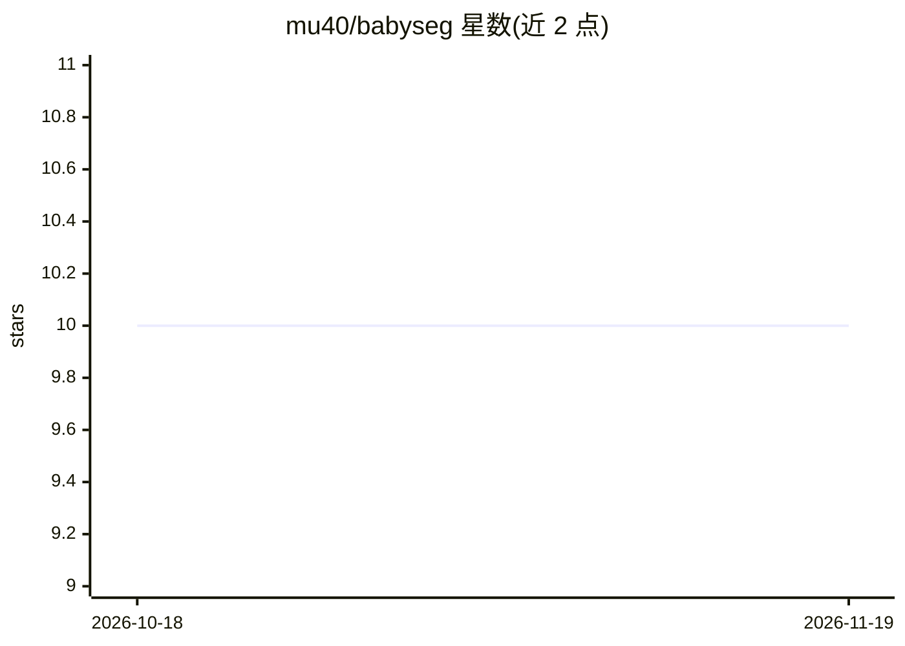

# mu40/babyseg

⭐ 10 · Python · MIT · 推送 2026-11-12 · [GitHub](https://github.com/mu40/babyseg) · [官网](https://babyseg.io) · 个人维护

**婴幼儿脑部 MRI 分割工具，无需预处理**

面向婴幼儿与幼儿脑部 MRI 的分割工具，用于在无预处理条件下勾勒解剖结构。支持整合多个对比度、形状、分辨率各异的 NIfTI 体数据，条件是头文件几何正确且在世界坐标系下对齐。推荐通过容器运行。附方法论文与数据引擎论文的引用信息及介绍视频。

## 筛选速览

| 维度 | 判定 | 备注 |
|---|---|---|
| AI 角色 | `ai-native` | 本体是模型或模型工具 |
| 许可风险 | `permissive` | MIT |
| 部署形态 | `None` |  |
| 模型依赖 | — | README 未给出锁定关系 |
| 硬件要求 | — | 无带数字的原话,不猜 |
| 安装摩擦 | `low` | 无编译、无系统依赖或容器化 |
| 成熟度 | — | 结构信号不足 |

## 能力要点

- 无需预处理即可对婴幼儿 MRI 分割
- 支持多变对比度/形状/分辨率的 NIfTI 多体数据整合
- 提供容器化运行方式

## 适用场景

- 婴幼儿脑部 MRI 解剖结构分割
- 多对比度 MRI 影像的整合分析

## 场景标签

 · 领域:医学影像/神经影像

## 证据(README 行号)

> L3: BabySeg is a brain segmentation tool for infants and young children, designed to delineate anatomical structures in 
> L4: The tool can integrate information from multiple NIfTI image volumes of variable contrast, shape, and resolution in 

## 星数曲线

2026-10-18 10 → 2026-11-19 10（+0）

---
*卡片 v1 · prompt 1.4 · 生成 2026-11-19 · 置信度 high · 依据 README sha `164bf4fec0e9` · [字段定义](../../DATASET.md)*
