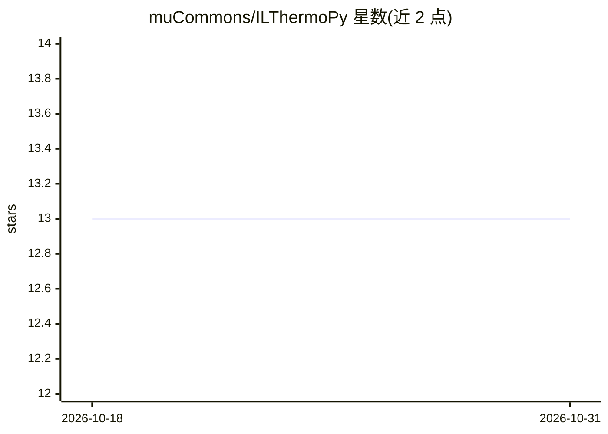

# muCommons/ILThermoPy

⭐ 13 · Python · MIT · 推送 2026-10-16 · [GitHub](https://github.com/muCommons/ILThermoPy) · [官网](https://mucommons.github.io/ILThermoPy/) · 个人维护

**给科研者：从 ILThermo 2.0 取数并附 SMILES 结构标注的 Python 客户端**

非官方 Python 包，从 ILThermo 2.0 网页服务检索离子液体实验物性数据记录，并用人工校验的存储映射将化合物标识符富集为 SMILES 等机器可读分子标识，供化学信息学、分子热力学与机器学习工作流使用。局限：依赖 ILThermo 网页服务当前行为（无稳定公开 API），ILThermo 更新后需刷新结构映射；自身定位为访问与富集层，非官方 API 或完整策划数据库。经 pip 从 PyPI 安装。

## 筛选速览

| 维度 | 判定 | 备注 |
|---|---|---|
| AI 角色 | `ai-knowledge` | 知识聚合/清单类 |
| 许可风险 | `permissive` | MIT |
| 部署形态 | `library` | 以包/库形式分发 |
| 模型依赖 | — | README 未给出锁定关系 |
| 硬件要求 | — | 无带数字的原话,不猜 |
| 安装摩擦 | `low` | 无编译、无系统依赖或容器化 |
| 成熟度 | — | 结构信号不足 |

## 能力要点

- 按性质、化合物或年份检索 ILThermo 记录
- 为已知离子液体组分附加人工校验的 SMILES 注释
- 提供 ILThermo 数据库更新后半自动刷新结构映射的脚本

## 适用场景

- 为描述符计算和 ML 流水线准备离子液体数据集
- 把热力学测量与阳离子/阴离子结构关联
- 检查哪些 ILThermo 化合物已有结构注释

## 场景标签

`科研工具` · 领域:学习与行业

## 证据(README 行号)

> L3: **ILThermoPy** is an unofficial Python package for retrieving data from
> L6: cheminformatics, molecular thermodynamics, and machine-learning workflows that
> L37: ILThermoPy bridges this gap by retrieving ILThermo records and adding stored

## 星数曲线

2026-10-18 13 → 2026-10-31 13（+0）

---
*卡片 v1 · prompt 1.4 · 生成 2026-10-31 · 置信度 high · 依据 README sha `3a81971b84f1` · [字段定义](../../DATASET.md)*
