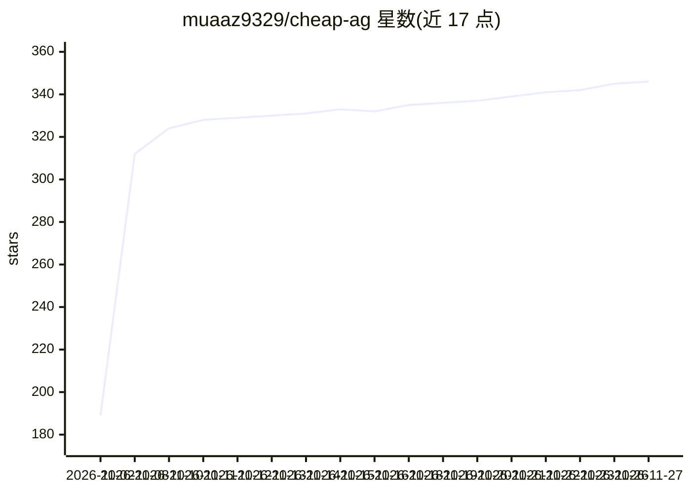

# muaaz9329/cheap-ag

⭐ 346 · TypeScript · MIT · 推送 2026-11-26 · [GitHub](https://github.com/muaaz9329/cheap-ag) · [官网](https://cheapag.com) · 个人维护

**为 Claude Code/Codex 接入低价模型的编码委托服务器**

以 npm 包与 MCP 服务器/插件形式安装到 Claude Code 或 Codex：将代码改写任务委托给低价模型，前端模型负责规划决策，低价模型在项目副本中先写失败测试再修复代码，Cheap Agent 自行运行测试、仅让通过检查的工作落地。支持 7 个提供方与任意 OpenAI 兼容端点（含本地 Ollama/llama.cpp/vLLM），提供 provider 切换、模型选择、命令允许列表、任务留存清理等配置。要求 Node.js 20+ 与 Claude Code 或 Codex。

## 筛选速览

| 维度 | 判定 | 备注 |
|---|---|---|
| AI 角色 | `ai-ecosystem` | LLM/agent 周边工具 |
| 许可风险 | `permissive` | MIT |
| 部署形态 | `desktop` | 安装包/桌面程序 |
| 模型依赖 | local-ok | 支持本地模型 |
| 硬件要求 | — | 无带数字的原话,不猜 |
| 安装摩擦 | `low` | 无编译、无系统依赖或容器化 |
| 成熟度 | — | 结构信号不足 |

## 能力要点

- 低价模型在项目副本工作，测试通过后才落地（先失败测试后修复）
- 支持 OpenRouter、DeepSeek、Ollama 等多提供方与任意 OpenAI 兼容端点
- git worktree 支持与 /cheapag:provider、/cheapag:model 等命令
- README 附 SWE-bench Verified 对照数据（含未解决 case 披露）

## 适用场景

- 在订阅计划内用低价模型承接日常编码任务以延长额度
- 让 Claude Code/Codex 保留规划角色、减少前端模型 token 消耗
- 用本地 Ollama 或自建 OpenAI 兼容端点执行编码任务

## 场景标签

`编码 Agent` `模型网关` · 领域:Agent 开发

## 证据(README 行号)

> L25: Works in Claude Code and Codex. One login covers both.
> L82: - Claude Code or Codex
> L165: **Cheap Agent fixes the org chart.** Your frontier model plans and decides. A model that costs half a cent per tas

## 星数曲线

2026-11-02 189 → 2026-11-27 346（+157）

---
*卡片 v1 · prompt 1.4 · 生成 2026-11-26 · 置信度 high · 依据 README sha `e4824512049c` · [字段定义](../../DATASET.md)*
