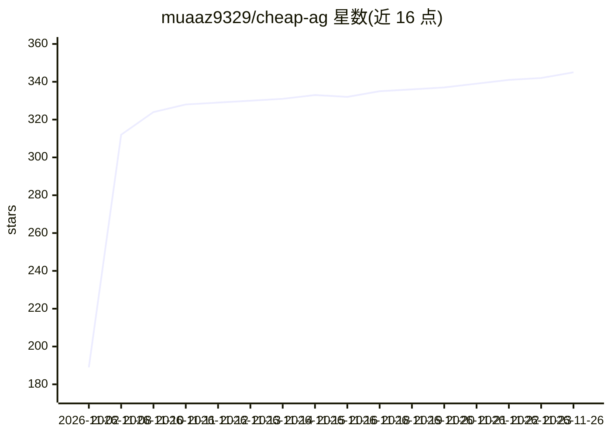

# muaaz9329/cheap-ag

⭐ 345 · TypeScript · MIT · 推送 2026-11-25 · [GitHub](https://github.com/muaaz9329/cheap-ag) · [官网](https://cheapag.com) · 个人维护

**为 Claude Code/Codex 委派廉价模型写代码的 MCP 插件**

以 npm 包和插件形式接入 Claude Code 与 Codex：前沿模型负责规划决策，低成本模型在项目的 git worktree 副本中实现代码并先写失败测试再修复，插件自行运行测试，仅通过的改动落回主检出，未验证的复现以风险说明、未提交状态落地。支持 7 家 provider、本地 Ollama 与任意 OpenAI 兼容端点，提供 provider 切换、模型选择、任务状态与清理等命令，并通过 hooks 阻止前沿模型重做已通过的工作。要求 Node.js 20+ 与 Claude Code 或 Codex，Windows 需 Git Bash。

## 筛选速览

| 维度 | 判定 | 备注 |
|---|---|---|
| AI 角色 | `ai-ecosystem` | LLM/agent 周边工具 |
| 许可风险 | `permissive` | MIT |
| 部署形态 | `desktop` | 安装包/桌面程序 |
| 模型依赖 | local-ok | 支持本地模型 |
| 硬件要求 | — | 无带数字的原话,不猜 |
| 安装摩擦 | `low` | 无编译、无系统依赖或容器化 |
| 成熟度 | — | 结构信号不足 |

## 能力要点

- 廉价模型在独立 worktree 中工作，改动须通过插件自跑的测试才能落地
- 支持 7 家 provider、本机/云端 Ollama 及任意 OpenAI 兼容自定义端点
- hooks 强制前沿模型将代码修改交由廉价模型执行
- 提供 SWE-bench Verified 上的 token 用量对比数据

## 适用场景

- 让 $20 的 Claude/ChatGPT 订阅额度覆盖更多任务
- 用 DeepSeek 等低价模型承担日常编码工作，前沿模型只做规划
- 用本机 Ollama 模型在不出网的情况下执行编码任务

## 场景标签

`编码 Agent` · 领域:编码与开发

## 证据(README 行号)

> L25: Works in Claude Code and Codex. One login covers both.
> L164: **Cheap Agent fixes the org chart.** Your frontier model plans and decides. A model that costs half a cent per tas

## 星数曲线

2026-11-02 189 → 2026-11-26 345（+156）

---
*卡片 v1 · prompt 1.4 · 生成 2026-11-25 · 置信度 high · 依据 README sha `0435bf0f96af` · [字段定义](../../DATASET.md)*
