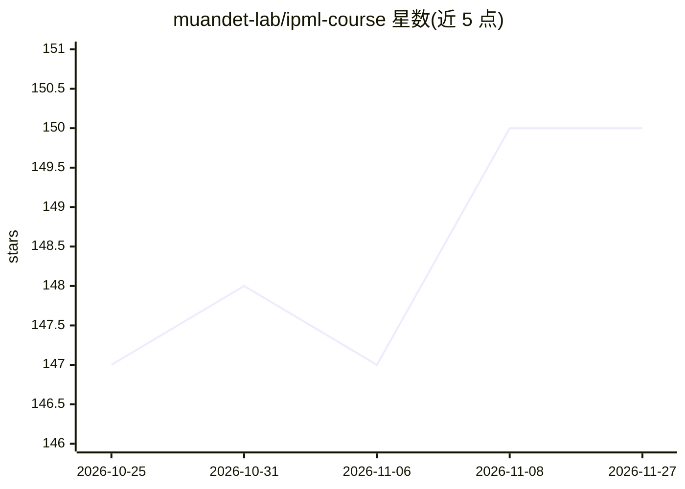

# muandet-lab/ipml-course

⭐ 150 · SCSS · MIT · 推送 2026-11-20 · [GitHub](https://github.com/muandet-lab/ipml-course) · 组织维护

**不精确概率机器学习课程资料与课程网站仓库**

托管 Imprecise Probabilistic Machine Learning（IPML）课程的网站与教学材料：基于 Jekyll 单站点组织多个学期的开课内容，每学期位于独立子目录并保留历史存档；顶层存放跨学期的课程描述与阅读清单。仓库说明如何发布讲义 PDF、课堂录像链接、课程表、练习题与解答、公告，以及开新学期的复制步骤；本地运行需 Ruby 3.1+ 与 Bundler，部署通过 GitHub Actions Pages 工作流完成。

## 筛选速览

| 维度 | 判定 | 备注 |
|---|---|---|
| AI 角色 | `ai-knowledge` | 知识聚合/清单类 |
| 许可风险 | `permissive` | MIT |
| 部署形态 | `None` |  |
| 模型依赖 | — | README 未给出锁定关系 |
| 硬件要求 | — | 无带数字的原话,不猜 |
| 安装摩擦 | `low` | 无编译、无系统依赖或容器化 |
| 成熟度 | — | 结构信号不足 |

## 能力要点

- 多学期课程内容的稳定 URL 组织与自动归档横幅
- 讲义/录像/课程表/练习题的发布流程说明
- 基于 Jekyll 的课程网站模板（含 MIT 许可模板致谢）
- GitHub Actions Pages 自动部署

## 适用场景

- 查阅 IPML 课程各学期的讲义与阅读清单
- 搭建类似的多学期课程网站
- 维护课程练习题与解答的发布流程

## 场景标签

`教程课程` · 领域:学习与行业

## 证据(README 行号)

> L7: This repository holds the course website and material for **Imprecise
> L21: The site is a single permanent Jekyll site in which

## 星数曲线

2026-10-25 147 → 2026-11-27 150（+3）

---
*卡片 v1 · prompt 1.4 · 生成 2026-11-27 · 置信度 high · 依据 README sha `8f4d9459f496` · [字段定义](../../DATASET.md)*
