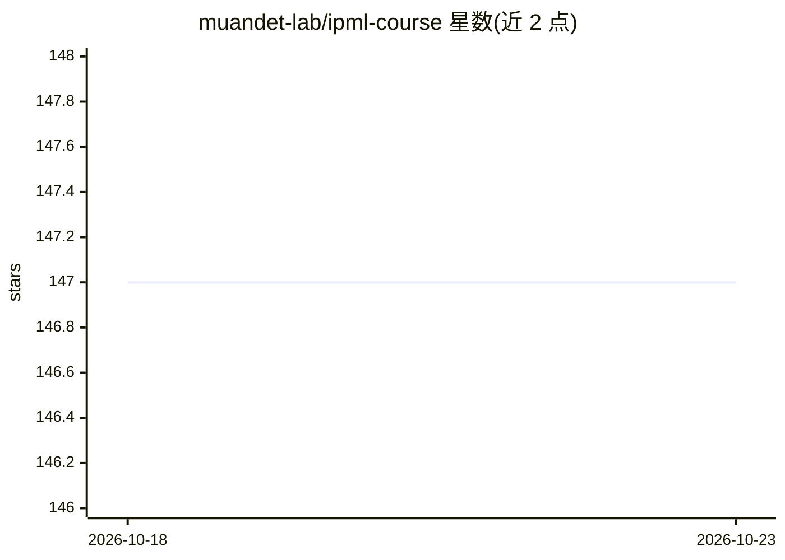

# muandet-lab/ipml-course

⭐ 147 · SCSS · MIT · 推送 2026-10-22 · [GitHub](https://github.com/muandet-lab/ipml-course) · 组织维护

**不精确概率机器学习课程的课程网站与教学资料仓库**

 hosting 于 muandet-lab 的 IPML（Imprecise Probabilistic Machine Learning）课程网站仓库：以单个永久 Jekyll 站点组织多个学期的开课内容，每学期位于独立子目录以保持 URL 可引用且不被新学期覆盖；内容含讲义幻灯片、练习题、公告与跨学期的阅读清单。README 记录常见维护任务（发布幻灯片、排课、发布习题）、新学期初始化流程、本地运行方式（Ruby 3.1+ 与 Bundler）及 GitHub Pages 部署，站点基于 jekyll-course-website-template。

## 筛选速览

| 维度 | 判定 | 备注 |
|---|---|---|
| AI 角色 | `ai-knowledge` | 知识聚合/清单类 |
| 许可风险 | `permissive` | MIT |
| 部署形态 | `None` |  |
| 模型依赖 | — | README 未给出锁定关系 |
| 硬件要求 | — | 无带数字的原话,不猜 |
| 安装摩擦 | `low` | 无编译、无系统依赖或容器化 |
| 成熟度 | — | 结构信号不足 |

## 能力要点

- 单一 Jekyll 站点按学期子目录组织，URL 长期可引用
- 统一的阅读清单以 include 复用于各学期导航
- 文档化新学期初始化与幻灯片/习题发布流程

## 适用场景

- 学生访问各学期 IPML 课程的讲义、习题与阅读清单
- 课程维护者发布幻灯片、排课与开设新学期
- 引用不精确概率机器学习方向的参考文献

## 场景标签

`教程课程` · 领域:学习与行业

## 证据(README 行号)

> L7: This repository holds the course website and material for **Imprecise
> L8: Probabilistic Machine Learning (IPML)**.

## 星数曲线

2026-10-18 147 → 2026-10-23 147（+0）

---
*卡片 v1 · prompt 1.4 · 生成 2026-10-22 · 置信度 high · 依据 README sha `ab714b2d3d67` · [字段定义](../../DATASET.md)*
