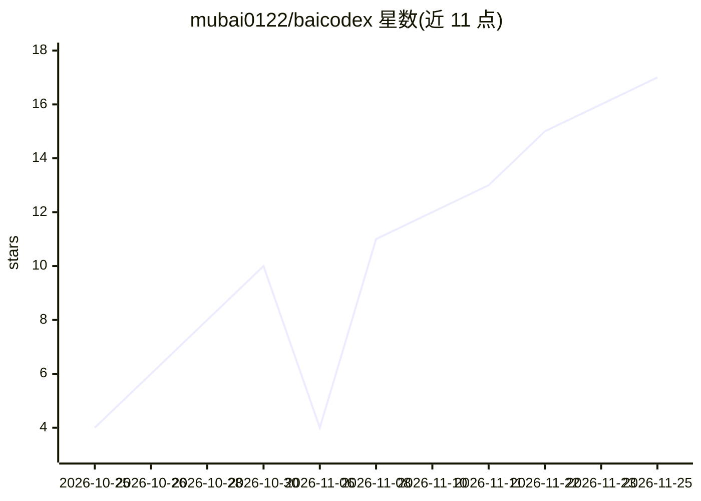

# mubai0122/baicodex

⭐ 17 · Kotlin · AGPL-3.0 · 推送 2026-11-23 · [GitHub](https://github.com/mubai0122/baicodex) · [官网](https://agent.ai.baiccb.cn) · 个人维护 · 中文 README

**设备端 Android AI Agent：直连模型执行文件、命令与屏幕操作**

以 Rust 内核 + Kotlin/Compose 界面构建的开源 Android Agent，运行在本机，模型直连、数据本地落库。核心机制：三档执行权限（普通 App / Shizuku / Root）、无障碍 UI 自动化、PRoot Linux 沙箱（apt/gcc/node）、工具调用循环、MCP 客户端与 A2A 互派任务。提供角色卡、长期记忆、消息分支、局域网多设备协作与米家/网易云原生集成。构建需 JDK 17 与 Android SDK 37；沙箱执行 guest 程序需 Root/Shizuku 通道。

## 筛选速览

| 维度 | 判定 | 备注 |
|---|---|---|
| AI 角色 | `ai-native` | 本体是模型或模型工具 |
| 许可风险 | `dual` | AGPL-3.0 |
| 部署形态 | `None` |  |
| 模型依赖 | — | README 未给出锁定关系 |
| 硬件要求 | — | 无带数字的原话,不猜 |
| 安装摩擦 | `high` | 编译与系统依赖俱全 |
| 成熟度 | — | 结构信号不足 |

## 能力要点

- 三档权限执行通道：普通 App 身份、Shizuku 免 Root、Root，工具内部自动选路
- 内置 proot + Ubuntu 24.04 rootfs 沙箱，支持 apt/gcc/node 编译运行
- 无障碍服务屏幕操作：节点树 dump、点击、滑动、输入，视觉+节点树双路
- MCP 客户端（JSON-RPC 2.0 over HTTP + REST 桥）与 A2A 1.0 规范互通

## 适用场景

- 在手机上用自然语言让 Agent 读写文件、跑脚本、定位报错
- 免 Root 通过无障碍服务让 Agent 自动点击操作其他 App 界面
- 局域网多台设备配对后互相派活、互传文件
- 接入米家设备与网易云音乐账号，用一句话串联控制与查询

## 场景标签

`AI 助手` `GUI 自动化` · 领域:效率与自动化

## 证据(README 行号)

> L7: **把 Android 当成自己身体的 AI Agent。** 它不只是聊天：你说「把后台清一下」「这个报错帮我定位」「写个脚本跑一下」，它会自己看屏幕、拆步骤、调工具、写代码、编译构建，做完再把结果交回来。全是真执行，不是演示。
> L9: **开源、on-device 的 Android Agent**：装在本机就能跑，不需要电脑陪跑，是 GitHub 上能自己编的 Android Agent 开源项目。挂 **Shizuku** 或 Root 拿系统级权限，内置 *
> L76: - **真的动手，不只是回话**：Agent 循环带工具调用，读文件、写文件、跑 shell、跑 Linux、点屏幕都是真执行，结果回灌给模型再走下一步

## 星数曲线

2026-10-25 4 → 2026-11-25 17（+13）

---
*卡片 v1 · prompt 1.4 · 生成 2026-11-18 · 置信度 high · 依据 README sha `1510023037ca` · [字段定义](../../DATASET.md)*
