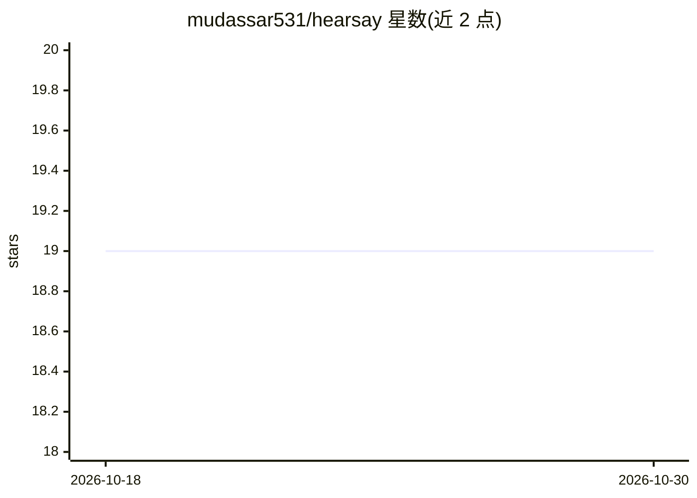

# mudassar531/hearsay

⭐ 19 · Python · MIT · 推送 2026-09-03 · [GitHub](https://github.com/mudassar531/hearsay) · [官网](https://pypi.org/project/hearsay/) · 个人维护

**把视频/播客转成带时间戳的 markdown 或可验证 TTS/STT 数据集的本地 CLI**

面向开发者的本地命令行工具：输入 YouTube 链接、播客 RSS 或本地录音，优先抓取现成字幕，无字幕时回退到本地 faster-whisper 或 Apple Silicon 上的 Parakeet 转录，输出干净的带时间戳 markdown（供 RAG/笔记/agent），或将音频按词级时间戳切成短片生成 LJSpeech/NeMo/HuggingFace audiofolder 布局的 TTS/STT 训练数据集。内置 hearsay verify 命令重转写抽样片段并输出 trainable/marginal/not trainable 判定。全程本地运行，系统依赖 ffmpeg；附 Web UI 与 MCP server 可选组件。

## 筛选速览

| 维度 | 判定 | 备注 |
|---|---|---|
| AI 角色 | `ai-native` | 本体是模型或模型工具 |
| 许可风险 | `permissive` | MIT |
| 部署形态 | `desktop` | 安装包/桌面程序 |
| 模型依赖 | — | README 未给出锁定关系 |
| 硬件要求 | — | 无带数字的原话,不猜 |
| 安装摩擦 | `medium` | 含编译或系统依赖之一 |
| 成熟度 | — | 结构信号不足 |

## 能力要点

- 字幕优先策略：有字幕直接抓取不下载媒体，否则回退本地 Whisper/Parakeet 转录
- 按词级时间戳切分音频（不从词中间切），生成 LJSpeech metadata.csv + NeMo manifest.jsonl 数据集
- hearsay verify 重转写抽样片段，核验音频与文本配对并输出 verification.md
- 默认质量过滤（时长/静音/脚本/语速/重复/置信度）并记录每条丢弃原因

## 适用场景

- 把 YouTube 视频或播客整理成 RAG 知识库或笔记用的 markdown
- 从播客或录音构建单说话人 TTS / STT 训练数据集
- 在训练前验证已有 LJSpeech/NeMo 数据集的音频-文本配对正确性

## 场景标签

`语音识别` `语音合成` `文档解析` · 领域:内容生成

## 证据(README 行号)

> L3: > **crawl4ai for video & audio.** One command turns any YouTube video, channel,
> L31: Captions when they exist (fast, no download); local **Whisper** or Apple-Silicon
> L89: `hearsay dataset` turns spoken media into a **machine-learning training dataset**:

## 星数曲线

2026-10-18 19 → 2026-10-30 19（+0）

---
*卡片 v1 · prompt 1.4 · 生成 2026-10-28 · 置信度 high · 依据 README sha `794036327cd1` · [字段定义](../../DATASET.md)*
