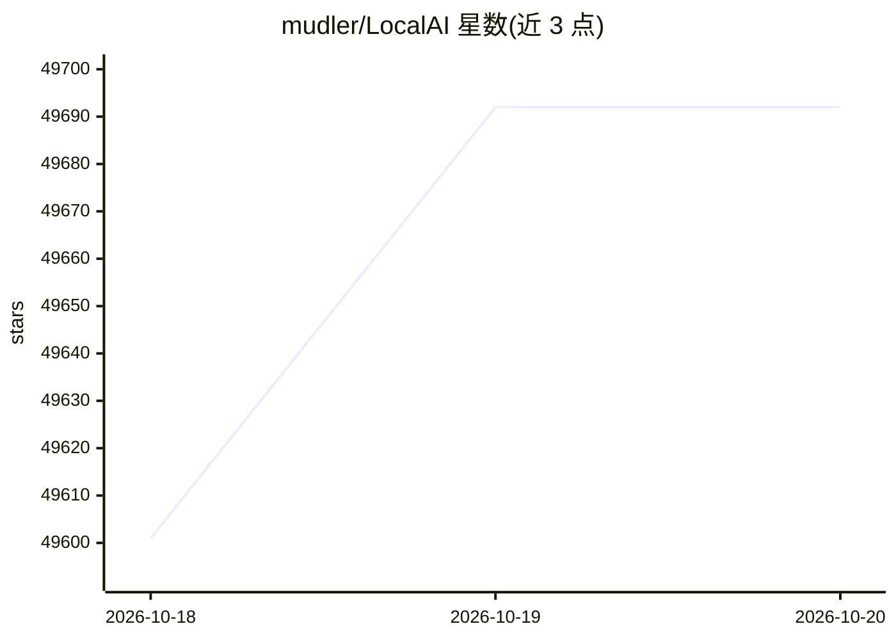

# mudler/LocalAI

⭐ 49,692 · Go · MIT · 推送 2026-10-19 · [GitHub](https://github.com/mudler/LocalAI) · [官网](https://localai.io) · 组织维护 · 中文 README

**本地运行各类 AI 模型的开源引擎，无需 GPU**

以小型核心加按需拉取后端镜像的架构运行 LLM、视觉、语音、图像、视频模型，每个后端封装 llama.cpp、vLLM、whisper.cpp 等引擎。提供 OpenAI/Anthropic/ElevenLabs 兼容 API、API key 认证与用户配额、内置带工具调用与 RAG 的 Agent、分布式模式与 WebUI。CPU 可运行，也支持 NVIDIA/AMD/Intel/Apple Silicon 加速；macOS 提供 DMG，其余通过容器镜像分发。

## 筛选速览

| 维度 | 判定 | 备注 |
|---|---|---|
| AI 角色 | `ai-native` | 本体是模型或模型工具 |
| 许可风险 | `permissive` | MIT |
| 部署形态 | `desktop` | 安装包/桌面程序 |
| 模型依赖 | local-ok | 支持本地模型 |
| 硬件要求 | `cpu-ok` | |
| 安装摩擦 | `low` | 无编译、无系统依赖或容器化 |
| 成熟度 | — | 结构信号不足 |

## 动量与使用信号

- 维护:`active` — 距上次 push 0.6 天,年发版 48,256 位贡献者
- 涨星:近 1 天 **+28**(自 20261016 起算)
- 平台:MACOS · 协议:OPENAI-API / MCP / OLLAMA

## 能力要点

- OpenAI、Anthropic、ElevenLabs API 兼容的多模态统一接口
- 60+ 后端按需以 OCI 镜像安装，含自研 C++/GGML 引擎
- 内置自主 Agent（工具调用、RAG、MCP、skills）
- 分布式集群模式（PostgreSQL + NATS）与 P2P 推理

## 适用场景

- 在无 GPU 的本地硬件上运行 LLM 和多模态模型
- 为应用提供 OpenAI 兼容的本地推理 API 端点
- 搭建多用户、带配额与认证的内部模型服务平台
- 运行本地语音识别、TTS、图像/视频生成服务

## 场景标签

`推理引擎` · 领域:训练与推理

## 证据(README 行号)

> L26: **LocalAI** is the open-source AI engine. Run any model - LLMs, vision, voice, image, video - on any hardware. No G
> L32: - **Drop-in API compatibility**: OpenAI, Anthropic, and ElevenLabs APIs across every backend
> L36: - **Built-in AI agents**: autonomous agents with tool use, RAG, MCP, and skills

## 星数曲线

2026-10-18 49,601 → 2026-10-20 49,692（+91）

---
*卡片 v1 · prompt 1.4 · 生成 2026-10-18 · 置信度 high · 依据 README sha `3c068e0f7ed0` · [字段定义](../../DATASET.md)*
