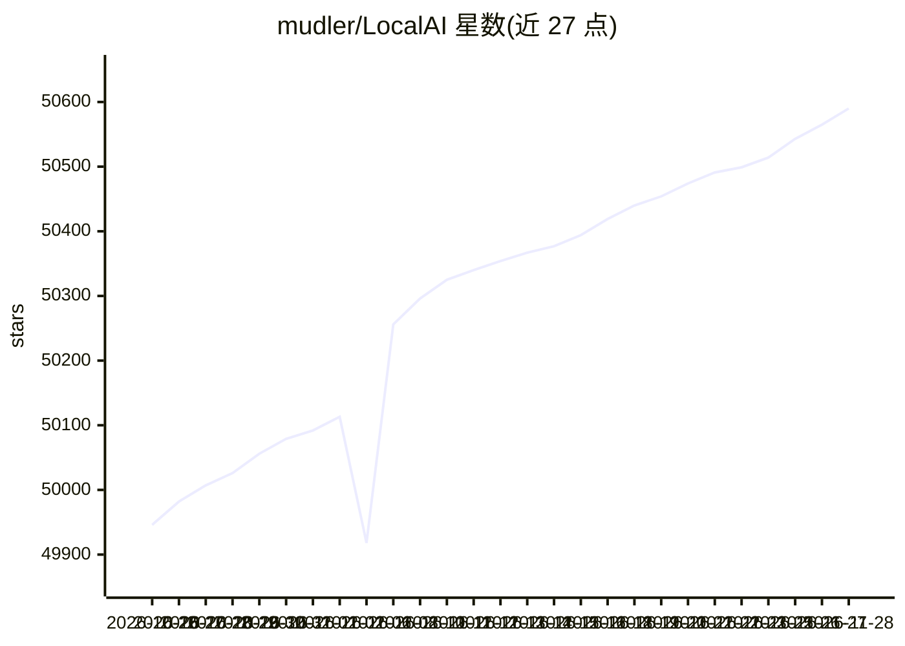

# mudler/LocalAI

⭐ 50,590 · Go · MIT · 推送 2026-11-27 · [GitHub](https://github.com/mudler/LocalAI) · [官网](https://localai.io) · 组织维护

**本地运行任意模型的推理服务端，兼容 OpenAI/Anthropic API**

LocalAI 是一个可在自有机器上运行多种开源模型（文本、视觉、语音、图像、视频）的推理引擎，对外提供 OpenAI 与 Anthropic 格式的 API，并附带聊天界面、agent、文件与团队协作功能。核心机制是 80 余个可插拔后端（多为 llama.cpp、vLLM 等上游引擎的封装，另含 18 个自研 C++/GGML 后端），按需拉取镜像；后端可经模型画廊动态安装。支持 Docker Compose、脚本、桌面应用与 Kubernetes 部署；无 GPU 也能运行，GPU 仅加速。分布式模式依赖 PostgreSQL 与 NATS。

## 筛选速览

| 维度 | 判定 | 备注 |
|---|---|---|
| AI 角色 | `ai-ecosystem` | LLM/agent 周边工具 |
| 许可风险 | `permissive` | MIT |
| 部署形态 | `self-host` | docker 或自建部署 |
| 模型依赖 | local-ok | 支持本地模型 |
| 硬件要求 | `cpu-ok` | |
| 安装摩擦 | `low` | 无编译、无系统依赖或容器化 |
| 成熟度 | — | 结构信号不足 |

## 动量与使用信号

- 维护:`active` — 距上次 push 0.6 天,年发版 48,256 位贡献者
- 涨星:近 1 天 **+28**(自 20261016 起算)
- 平台:MACOS · 协议:OPENAI-API / MCP / OLLAMA

## 能力要点

- 80+ 可插拔后端，统一以 OpenAI/Anthropic 兼容 API 暴露文本、语音、图像、视频、嵌入与重排能力
- 自研 18 个 C++/GGML 后端（vllm.cpp、parakeet.cpp、RF-DETR 检测、TTS/ASR 等），推理不含 Python
- 支持 CPU-only 运行与 NVIDIA/AMD/Intel/Apple Silicon/Vulkan/Jetson 加速，模型与数据留在本机
- 模型画廊与后端画廊动态安装，支持 MCP 客户端/服务端、分布式模式（PostgreSQL+NATS）与 P2P

## 适用场景

- 在内网或离线环境用自有硬件搭建 OpenAI 兼容的模型推理服务
- 为团队提供带权限、配额和共享目录的聊天与 agent 平台
- 在无 GPU 的笔记本或服务器上运行本地 LLM 和语音/图像模型

## 场景标签

`推理引擎` `图像生成` `语音合成` `语音识别` · 领域:内容生成

## 证据(README 行号)

> L13: **LocalAI** runs open models for chat, images, speech and video on your own machines. The API speaks the OpenAI and
> L20: LocalAI is a small core with an API, chats and agents, files, collections, team sharing, a model gallery and an MCP
> L17: - **Every kind of model, one API**: text, vision, speech to text, text to speech, images, video, music and sound, e

## 星数曲线

2026-10-26 49,946 → 2026-11-28 50,590（+644）

---
*卡片 v1 · prompt 1.4 · 生成 2026-11-27 · 置信度 high · 依据 README sha `abe2d05abaa5` · [字段定义](../../DATASET.md)*
