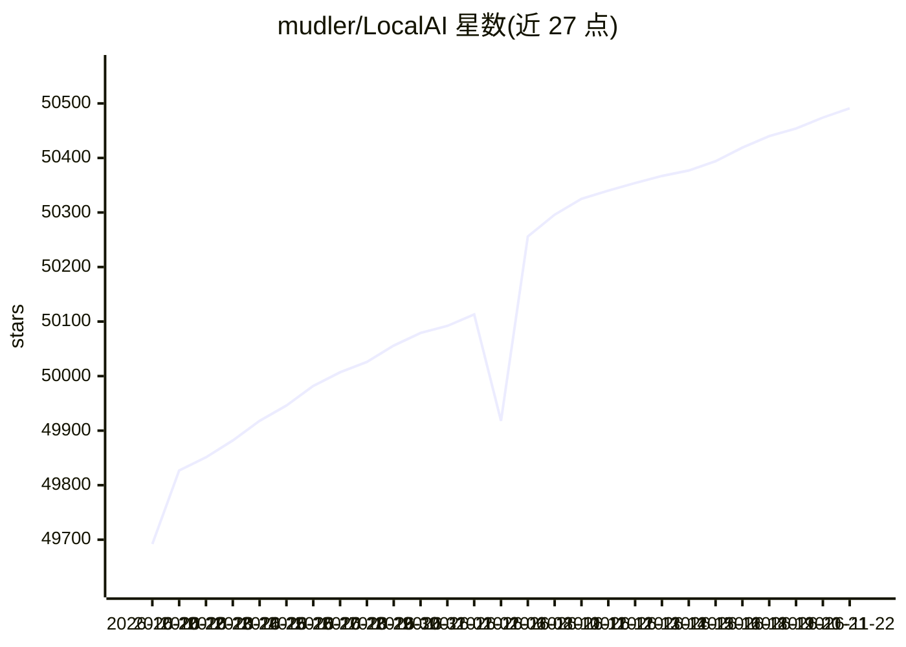

# mudler/LocalAI

⭐ 50,491 · Go · MIT · 推送 2026-11-21 · [GitHub](https://github.com/mudler/LocalAI) · [官网](https://localai.io) · 组织维护

**本地运行开源模型的推理服务：团队自托管聊天/语音/图像 API**

在自有机器上运行开源模型的推理服务，API 兼容 OpenAI 与 Anthropic 格式，覆盖文本、视觉、语音、图像、视频、音频生成、嵌入与重排序。含 80 余个后端（多数封装 llama.cpp、vLLM 等上游引擎，18 个为自研 C++/GGML 实现）、模型画廊、Web UI、聊天与 agent 功能、MCP 客户端/服务端、用户角色配额、分布式模式（PostgreSQL + NATS）与 P2P。提供安装脚本、Docker 镜像（含 GPU 版）及 macOS/Linux 桌面应用，MIT 许可。

## 筛选速览

| 维度 | 判定 | 备注 |
|---|---|---|
| AI 角色 | `ai-ecosystem` | LLM/agent 周边工具 |
| 许可风险 | `permissive` | MIT |
| 部署形态 | `self-host` | docker 或自建部署 |
| 模型依赖 | local-ok | 支持本地模型 |
| 硬件要求 | `cpu-ok` | |
| 安装摩擦 | `low` | 无编译、无系统依赖或容器化 |
| 成熟度 | — | 结构信号不足 |

## 动量与使用信号

- 维护:`active` — 距上次 push 0.6 天,年发版 48,256 位贡献者
- 涨星:近 1 天 **+28**(自 20261016 起算)
- 平台:MACOS · 协议:OPENAI-API / MCP / OLLAMA

## 能力要点

- API 兼容 OpenAI 与 Anthropic 格式，覆盖文本/语音/图像/视频等模型类型
- 80 余个后端，含 18 个自研 C++/GGML 无 Python 推理引擎
- 可在 CPU、NVIDIA、AMD、Intel、Apple Silicon、Vulkan 上运行，无需 GPU
- 提供聊天、agent、MCP、模型画廊、团队共享与分布式模式

## 适用场景

- 在自有服务器上为团队提供 OpenAI 格式兼容的模型 API
- 无 GPU 环境下本地运行大模型
- 部署语音转写、TTS、图像生成等多模态服务
- 管理多个模型后端与量化模型分发的团队场景

## 场景标签

`推理引擎` `图像生成` `语音合成` `语音识别` · 领域:内容生成

## 证据(README 行号)

> L13: **LocalAI** runs open models for chat, images, speech and video on your own machines. The API speaks the OpenAI and
> L17: - **Every kind of model, one API**: text, vision, speech to text, text to speech, images, video, music and sound, e
> L20: LocalAI is a small core with an API, chats and agents, files, collections, team sharing, a model gallery and an MCP

## 星数曲线

2026-10-20 49,692 → 2026-11-22 50,491（+799）

---
*卡片 v1 · prompt 1.4 · 生成 2026-11-22 · 置信度 high · 依据 README sha `19aaa1f97ded` · [字段定义](../../DATASET.md)*
