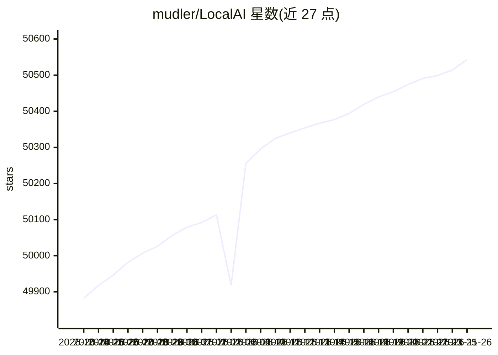

# mudler/LocalAI

⭐ 50,543 · Go · MIT · 推送 2026-11-25 · [GitHub](https://github.com/mudler/LocalAI) · [官网](https://localai.io) · 组织维护

**本地运行多模态开源模型的 OpenAI 兼容 AI 引擎**

以 MIT 许可发布的本地推理服务：在同一 API 下以 OpenAI 与 Anthropic 格式运行文本、视觉、语音、图像、视频、嵌入与重排序等模型，内置 80 多个后端，多数封装上游引擎（llama.cpp、vLLM 等），其中 18 个为自研 C++/GGML 实现。附带聊天、Agent（工具/MCP/技能）、文件与团队共享、模型画廊和附加组件库。提供桌面应用、安装脚本、容器镜像与 Kubernetes 部署，可在 CPU 上运行，GPU 可加速。

## 筛选速览

| 维度 | 判定 | 备注 |
|---|---|---|
| AI 角色 | `ai-ecosystem` | LLM/agent 周边工具 |
| 许可风险 | `permissive` | MIT |
| 部署形态 | `self-host` | docker 或自建部署 |
| 模型依赖 | local-ok | 支持本地模型 |
| 硬件要求 | `cpu-ok` | |
| 安装摩擦 | `low` | 无编译、无系统依赖或容器化 |
| 成熟度 | — | 结构信号不足 |

## 动量与使用信号

- 维护:`active` — 距上次 push 0.6 天,年发版 48,256 位贡献者
- 涨星:近 1 天 **+28**(自 20261016 起算)
- 平台:MACOS · 协议:OPENAI-API / MCP / OLLAMA

## 能力要点

- 单 API 以 OpenAI/Anthropic 兼容格式提供文本、语音、图像、视频、嵌入等多模态能力
- 80+ 后端，含 18 个自研 C++/GGML 后端（vllm.cpp、parakeet.cpp 等），推理无需 Python
- 支持 CPU-only 运行，加速覆盖 NVIDIA/AMD/Intel/Apple Silicon/Vulkan/Jetson
- 内置 Agent、MCP 客户端与服务端、模型画廊与分布式模式（PostgreSQL + NATS / P2P）

## 适用场景

- 在内网或个人机器上搭建不外发数据的模型服务
- 用 OpenAI 兼容 API 接入现有应用并切换本地模型
- 团队共享聊天、文件与 Agent，配合角色与配额管理
- 在无 GPU 的 CPU 环境运行语音、视觉与文本模型

## 场景标签

`推理引擎` `图像生成` `语音合成` `目标检测` · 领域:内容生成

## 证据(README 行号)

> L13: **LocalAI** runs open models for chat, images, speech and video on your own machines. The API speaks the OpenAI and
> L17: - **Every kind of model, one API**: text, vision, speech to text, text to speech, images, video, music and sound, e
> L20: LocalAI is a small core with an API, chats and agents, files, collections, team sharing, a model gallery and an MCP

## 星数曲线

2026-10-24 49,882 → 2026-11-26 50,543（+661）

---
*卡片 v1 · prompt 1.4 · 生成 2026-11-26 · 置信度 high · 依据 README sha `5ae90809ed3e` · [字段定义](../../DATASET.md)*
