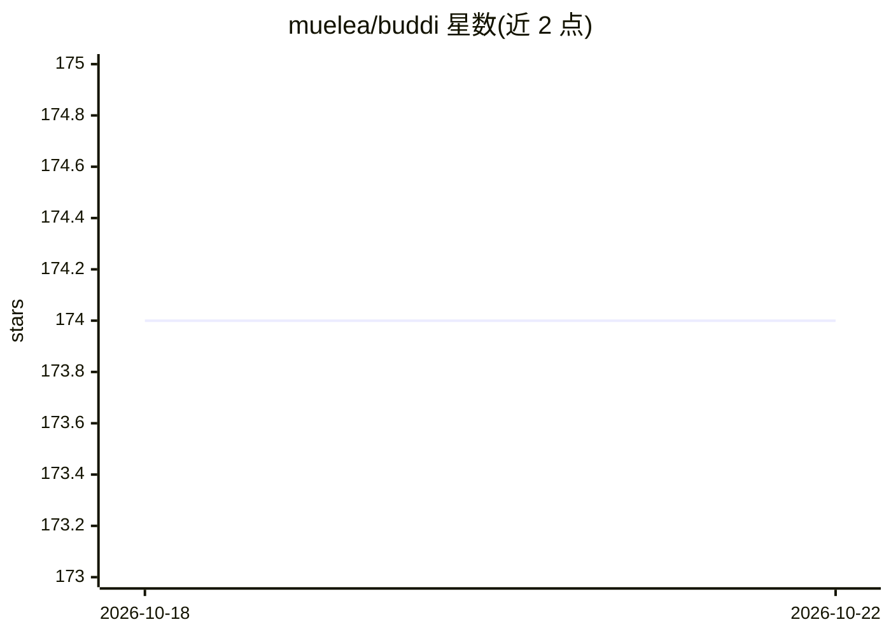

# muelea/buddi

⭐ 174 · Python · MIT · 推送 2026-05-07 · [GitHub](https://github.com/muelea/buddi) · [官网](https://muelea.github.io/buddi/) · 组织维护

**生成两人交互 3D 人体网格的扩散模型（CVPR 2024）**

BUDDI 是一个学习近距离双人交互联合分布的扩散模型，直接生成两人的 SMPL-X 人体参数；支持无条件采样、BEV 条件版本，并可作为先验通过 SDS 损失（借鉴 DreamFusion）对自有图像做优化拟合，不需真实接触标注。仓库提供推理、训练、优化与 Flickr Fits 数据构建全流程代码，以及 Google Colab 和自定义图像 demo。评测基于 FlickrCI3D、CHI3D、HI4D 数据集与 SMPL-X 参数 FID。面向 3D 人体研究领域的科研用户，安装依赖 conda 环境、ViTPose 与 BEV。

## 筛选速览

| 维度 | 判定 | 备注 |
|---|---|---|
| AI 角色 | `ai-native` | 本体是模型或模型工具 |
| 许可风险 | `permissive` | MIT |
| 部署形态 | `None` |  |
| 模型依赖 | — | README 未给出锁定关系 |
| 硬件要求 | — | 无带数字的原话,不猜 |
| 安装摩擦 | `low` | 无编译、无系统依赖或容器化 |
| 成熟度 | — | 结构信号不足 |

## 能力要点

- 扩散模型直接生成两人 SMPL-X 参数
- BUDDI 作先验经 SDS 损失优化自有图像，无需接触标注
- 支持无条件采样与 BEV 条件两个版本
- 提供推理/训练/优化/评测与 Flickr Fits 全流程代码

## 适用场景

- 生成双人近距离交互的 3D 人体姿态与形状
- 用自己的照片优化拟合两人 SMPL-X 网格
- 在 FlickrCI3D/CHI3D 上复现论文评测

## 场景标签

 · 领域:3D 计算机视觉/人体建模

## 证据(README 行号)

> L9: ... BUDDI, a diffusion model that learned the joint distribution of two people in close proxeminty -- thus a a BUD d
> L11: ... Optimization with BUDDI, we use BUDDI as a prior during optimization via an SDS loss inspired by DreamFusion. T

## 星数曲线

2026-10-18 174 → 2026-10-22 174（+0）

---
*卡片 v1 · prompt 1.4 · 生成 2026-10-22 · 置信度 high · 依据 README sha `e32a99f5e0bc` · [字段定义](../../DATASET.md)*
