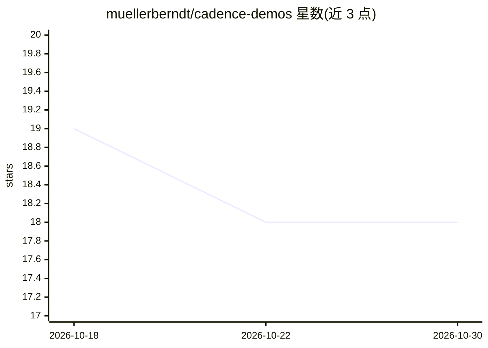

# muellerberndt/cadence-demos

⭐ 18 · JavaScript · 推送 2026-10-26 · [GitHub](https://github.com/muellerberndt/cadence-demos) · [官网](https://floatingpragma.io/) · 个人维护

**Cadence 学习大脑的示例应用集：演示在线学习与定居机制**

muellerberndt 维护的 Cadence 库配套示例仓库，含 7 个演示：Rover Lab（仿真月球车从测量运动中在线适应体模型）、Patch World（浏览器中进化定居大脑）、Atari Arcade（从像素学习 Atari 游戏）、Amen（记录补丁在浏览器合成丛林音乐）、Eyes（单个大脑追踪页面像素中的形状）、Connectome（在实测动物接线上的教学电路）、Robot Arena（零件组装机器人配单个持续大脑对战）。多数演示提供浏览器版本，本地用 Python venv 与 http.server 运行。作者声明项目处于早期研究阶段，示例不完整且随库变动。

## 筛选速览

| 维度 | 判定 | 备注 |
|---|---|---|
| AI 角色 | `ai-native` | 本体是模型或模型工具 |
| 许可风险 | `none` | — |
| 部署形态 | `library` | 以包/库形式分发 |
| 模型依赖 | — | README 未给出锁定关系 |
| 硬件要求 | — | 无带数字的原话,不猜 |
| 安装摩擦 | `low` | 无编译、无系统依赖或容器化 |
| 成熟度 | `idea` | |

## 能力要点

- 7 个演示分别展示定居、在线学习、进化、记录补丁等机制
- 多数演示有纯浏览器版本（部分经 Pyodide 运行发布的库本身）
- 各演示 README 标明所用 Cadence 版本与机制实现

## 适用场景

- 研究具身大脑的在线学习与局部修复机制
- 在浏览器中交互观察大脑定居与预测误差
- 对比 Cadence 大脑与前馈网络的行为差异

## 场景标签

`教程课程` · 领域:学习与行业

## 证据(README 行号)

> L3: Small example applications for Cadence:
> L104: |Rover Lab|A live body model that adapts from measured motion after a motor bootstrap|The population solver; in th
> L152: Brains born at server start learn Atari games from the raw screen while you
> L193: frozen in the page, on the released Cadence wheel in Pyodide.

## 星数曲线

2026-10-18 19 → 2026-10-30 18（-1）

---
*卡片 v1 · prompt 1.4 · 生成 2026-10-29 · 置信度 mid · 依据 README sha `ead827cfae04` · [字段定义](../../DATASET.md)*
