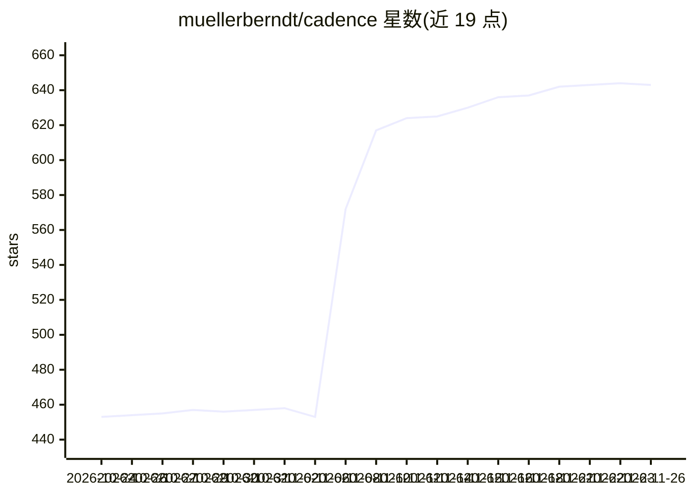

# muellerberndt/cadence

⭐ 643 · Python · GPL-3.0 · 推送 2026-11-25 · [GitHub](https://github.com/muellerberndt/cadence) · [官网](https://cadence.floatingpragma.ai/) · 个人维护

**面向研究者的持续在线学习神经网络 Python 库**

Cadence 是一个以平衡网络为基础的 Python 库，模拟在没有反向传播的情况下从经验中学习的类脑系统：神经元通过相互驱动收敛到稳定状态，动作从该状态读取，每个突触依据两次收敛的差异局部更新。提供 System 1（感知/记忆/可塑性/动作）与可选的 System 2 观察者递归反馈、记忆生长与嫁接、想象机制。Python 3.11+ 运行，标注为 alpha 研究软件。

## 筛选速览

| 维度 | 判定 | 备注 |
|---|---|---|
| AI 角色 | `ai-native` | 本体是模型或模型工具 |
| 许可风险 | `viral` | GPL-3.0 |
| 部署形态 | `library` | 以包/库形式分发 |
| 模型依赖 | — | README 未给出锁定关系 |
| 硬件要求 | — | 无带数字的原话,不猜 |
| 安装摩擦 | `medium` | 含编译或系统依赖之一 |
| 成熟度 | `idea` | |

## 能力要点

- 局部可塑性学习：无反向传播、无训练/使用切换
- 支持记忆生长（grow）、供体脑嫁接（graft）与想象推理
- 可选 PyTorch（NVIDIA）、MLX（Apple）、Numba 后端
- 浏览器实时演示：机械臂、Atari、Connect Four 等

## 适用场景

- 研究在线/局部学习算法并与反向传播网络对比
- 构建持续交互中学习的智能体（游戏、机械臂）
- 复现平衡传播类学习机制的基准实验

## 场景标签

`模型训练` `科研工具` · 领域:学习与行业

## 证据(README 行号)

> L12: Cadence is a Python library for brains that learn while they live. Animal and human brains learn
> L34: The brain settles: its neurons drive each other until their activity comes to rest, the action
> L54: failed and cheap stable operation are work in progress; Cadence is alpha research software.

## 星数曲线

2026-10-24 453 → 2026-11-26 643（+190）

---
*卡片 v1 · prompt 1.4 · 生成 2026-11-26 · 置信度 high · 依据 README sha `da33d2854ff9` · [字段定义](../../DATASET.md)*
