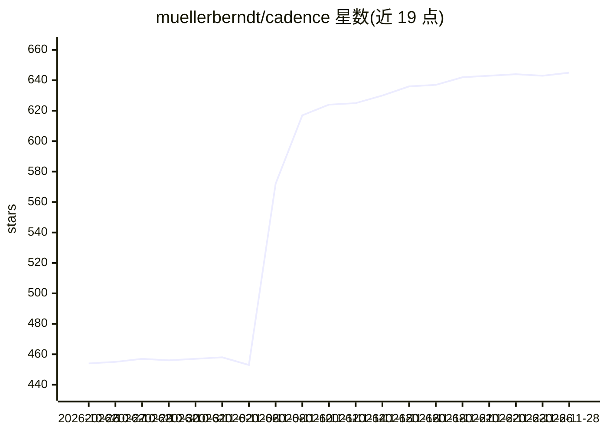

# muellerberndt/cadence

⭐ 645 · Python · GPL-3.0 · 推送 2026-11-27 · [GitHub](https://github.com/muellerberndt/cadence) · [官网](https://cadence.floatingpragma.ai/) · 组织维护

**给研究者用的在线局部学习神经网络 Python 库**

Cadence 是一个 Python 库，实现持续运行的平衡态神经网络：连接在运行中以局部可塑性规则更新，无反向传播，训练与使用不分离。默认提供 System 1（感知、记忆、可塑性与动作，含工作痕迹、历史、回忆与联想四种记忆），可选 System 2 观察者区域做慢速修正。需 Python 3.11+ 与 NumPy，可选 Numba/SciPy 加速，支持 CUDA 与 Apple MLX 后端；README 标注其为 alpha 研究软件，部分能力仍在开发中。

## 筛选速览

| 维度 | 判定 | 备注 |
|---|---|---|
| AI 角色 | `ai-native` | 本体是模型或模型工具 |
| 许可风险 | `viral` | GPL-3.0 |
| 部署形态 | `library` | 以包/库形式分发 |
| 模型依赖 | — | README 未给出锁定关系 |
| 硬件要求 | — | 无带数字的原话,不猜 |
| 安装摩擦 | `medium` | 含编译或系统依赖之一 |
| 成熟度 | `idea` | |

## 能力要点

- 局部可塑性在线学习，无反向传播、无训练/使用切换
- Brain.compose 一接口组装含四种记忆的持续大脑
- 支持 Numba/SciPy、CUDA (PyTorch) 与 Apple MLX 后端
- 浏览器内实时演示（机械臂、Atari、Connect Four 等）

## 适用场景

- 研究平衡传播与局部学习机制
- 构建从连续交互流中在线学习的智能体
- 在仿真环境中测试记忆、奖励与持续学习

## 场景标签

`科研工具` · 领域:学习与行业

## 证据(README 行号)

> L12: Cadence is a Python library for brains that learn while they live. Animal and human brains learn
> L34: The brain settles: its neurons drive each other until their activity comes to rest, the action
> L161: ## For machine-learning readers

## 星数曲线

2026-10-26 454 → 2026-11-28 645（+191）

---
*卡片 v1 · prompt 1.4 · 生成 2026-11-28 · 置信度 high · 依据 README sha `97d0bd6b5510` · [字段定义](../../DATASET.md)*
