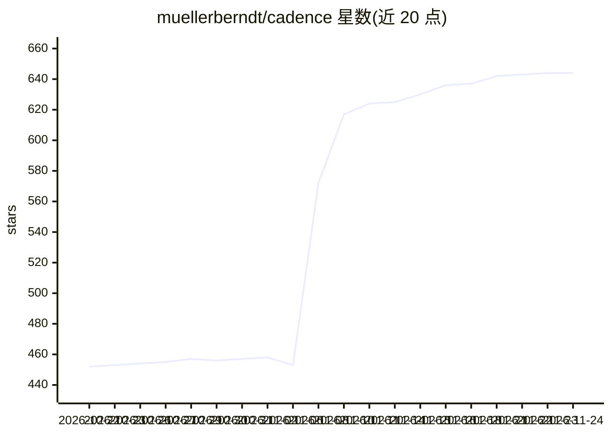

# muellerberndt/cadence

⭐ 644 · Python · GPL-3.0 · 推送 2026-11-23 · [GitHub](https://github.com/muellerberndt/cadence) · [官网](https://cadence.floatingpragma.ai/) · 组织维护

**持续在线学习的类脑 Python 库，边运行边学习**

Cadence 是一个 Python 库，提供在持续运行中学习的均衡网络（equilibrium network）：神经元互相驱动直至活动稳定，动作从稳定状态读取，突触通过自由与受扰两相位之差做局部更新，无反向传播、无训练/使用切换。System 1 组合感知、记忆与动作；可选 System 2 增加观察者区域做递归反馈。需 Python 3.11+ 与 NumPy，可选 Numba/SciPy、MLX 或 PyTorch 加速。作者声明为 alpha 研究软件，世界预测与修复机制仍在开发中。

## 筛选速览

| 维度 | 判定 | 备注 |
|---|---|---|
| AI 角色 | `ai-native` | 本体是模型或模型工具 |
| 许可风险 | `viral` | GPL-3.0 |
| 部署形态 | `library` | 以包/库形式分发 |
| 模型依赖 | — | README 未给出锁定关系 |
| 硬件要求 | — | 无带数字的原话,不猜 |
| 安装摩擦 | `medium` | 含编译或系统依赖之一 |
| 成熟度 | `idea` | |

## 能力要点

- 局部可塑性的持续在线学习，无反向传播与训练/推理切换
- 工作痕迹、历史、回忆与联想四种记忆机制
- 可保存/恢复的大脑、移植训练区域、想象不改动在线状态
- 提供浏览器实时演示（机械臂、Atari、Connect Four 等）

## 适用场景

- 研究持续/在线学习与均衡传播机制
- 为机器人或游戏环境构建边运行边学习的控制器
- 从奖励流中训练动作策略并与前馈网络对比

## 场景标签

`强化学习` `模型训练` · 领域:训练与推理

## 证据(README 行号)

> L12: Cadence is a Python library for brains that learn while they live. Animal and human brains learn
> L34: The brain settles: its neurons drive each other until their activity comes to rest, the action
> L184: |Settling brain (`Genome`, `develop`, `NeuralGraph`, `Learner`)|A continuous Hopfield or energy-based recurrent ne

## 星数曲线

2026-10-22 452 → 2026-11-24 644（+192）

---
*卡片 v1 · prompt 1.4 · 生成 2026-11-24 · 置信度 high · 依据 README sha `791e658421e6` · [字段定义](../../DATASET.md)*
