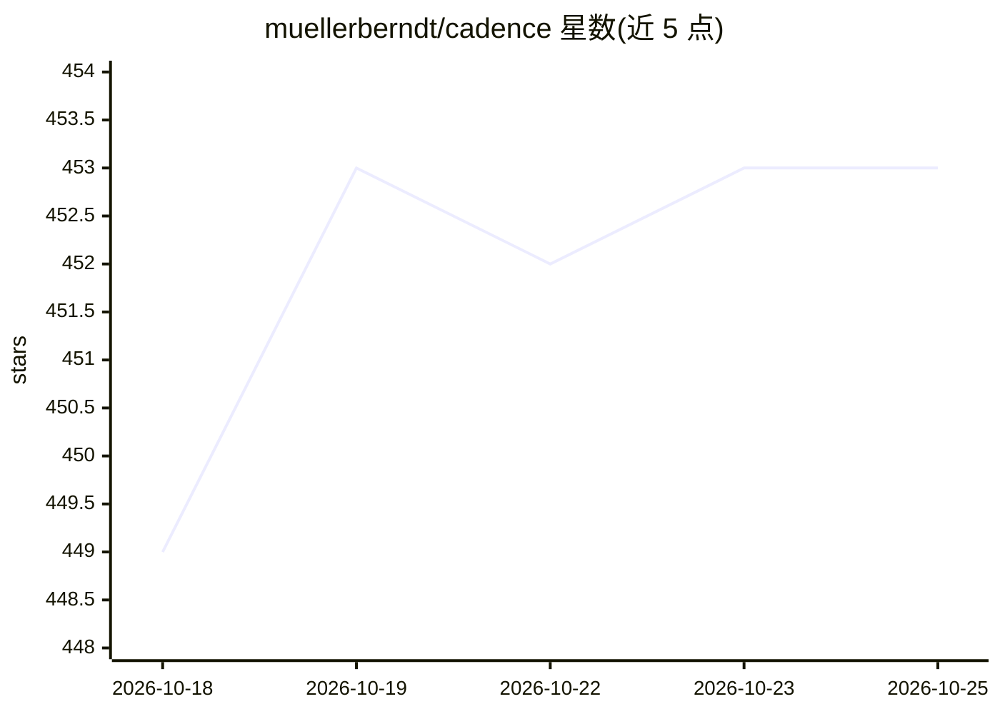

# muellerberndt/cadence

⭐ 454 · Python · GPL-3.0 · 推送 2026-10-25 · [GitHub](https://github.com/muellerberndt/cadence) · [官网](https://floatingpragma.io/) · 个人维护

**研究用类脑在线学习库：持续感知、记忆与行动**

Cadence 是 GPL v3 许可的 Python 研究库（alpha 阶段），构建一个持续运行的平衡态'模拟大脑'：默认 System 1 提供感知、局部可塑连接、记忆与动作；可选 System 2 增加观察皮层区域反馈到同一神经图。学习机制比较自由相位与受迫相位的局部活动，无反向微分过程；无训练/推理模式切换，在线持续学习。需要 Python 3.11+ 与 NumPy，通过 pip 安装 cadence-net。作者自述世界预测、局部修复等特性仍在开发中。

## 筛选速览

| 维度 | 判定 | 备注 |
|---|---|---|
| AI 角色 | `ai-native` | 本体是模型或模型工具 |
| 许可风险 | `viral` | GPL-3.0 |
| 部署形态 | `library` | 以包/库形式分发 |
| 模型依赖 | — | README 未给出锁定关系 |
| 硬件要求 | — | 无带数字的原话,不猜 |
| 安装摩擦 | `low` | 无编译、无系统依赖或容器化 |
| 成熟度 | `idea` | |

## 能力要点

- Brain.compose/live 单一接口构建并运行持续大脑
- 局部可塑性学习：自由与受迫两相位比较，无反向传播
- 支持保存续跑、私有想象（imagine）不改动在线记忆
- 可选 System 2 观察区域与情节/回忆记忆选项

## 适用场景

- 研究具身智能的在线学习与行为习得
- 测试获取、保持与恢复能力的持续学习实验
- 探索类脑递归/平衡网络替代前馈网络的场景

## 场景标签

 · 领域:机器学习研究/类脑计算

## 证据(README 行号)

> L25: Cadence builds a simulated animal-like brain from simplified biological
> L26: mechanisms. Its default **System 1** is one continuing brain with perception,

## 星数曲线

2026-10-18 449 → 2026-10-25 453（+4）

---
*卡片 v1 · prompt 1.4 · 生成 2026-10-21 · 置信度 high · 依据 README sha `aca18cd13ecf` · [字段定义](../../DATASET.md)*
