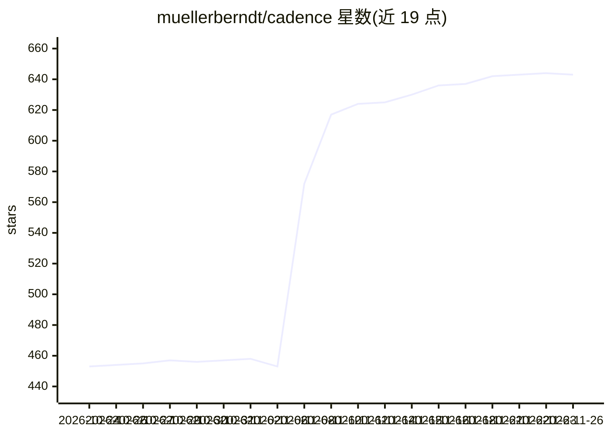

# muellerberndt/cadence

⭐ 643 · Python · GPL-3.0 · 推送 2026-11-25 · [GitHub](https://github.com/muellerberndt/cadence) · [官网](https://cadence.floatingpragma.ai/) · 组织维护

**在线持续学习的类脑神经网络 Python 库**

Cadence 是一个 Python 库，提供以平衡传播（equilibrium contrast）方式在线学习的循环网络：连接在运行过程中局部更新，无反向传播、无训练/使用切换；带工作轨迹、历史、回忆与联想四类记忆，支持奖励学习、teacher 标签、保存/恢复、区域嫁接与私有 imagination 推演，可选 observer 递归区域（System 2）。定位为 alpha 研究软件，需 Python 3.11+ 与 NumPy，默认 NumPy float64 CPU 运行，可选 Numba/MLX/PyTorch 加速。面向机器学习研究者与具身/机器人方向开发者。

## 筛选速览

| 维度 | 判定 | 备注 |
|---|---|---|
| AI 角色 | `ai-native` | 本体是模型或模型工具 |
| 许可风险 | `viral` | GPL-3.0 |
| 部署形态 | `library` | 以包/库形式分发 |
| 模型依赖 | — | README 未给出锁定关系 |
| 硬件要求 | — | 无带数字的原话,不猜 |
| 安装摩擦 | `medium` | 含编译或系统依赖之一 |
| 成熟度 | `idea` | |

## 能力要点

- 无反向传播的局部可塑性学习（自由/受扰相位对比）
- 持续状态与四类记忆（工作轨迹、历史、回忆、联想）
- 支持 grow/graft 组合脑区与保存后续跑
- 可选 MLX（Apple GPU）与 PyTorch（NVIDIA GPU）后端

## 适用场景

- 研究在线/持续学习与平衡传播机制
- 机器人或游戏环境中的边行动边学习实验
- 复现并与反向传播网络做同任务对比

## 场景标签

`模型训练` · 领域:训练与推理

## 证据(README 行号)

> L12: Cadence is a Python library for brains that learn while they live. Animal and human brains learn
> L34: The brain settles: its neurons drive each other until their activity comes to rest, the action
> L161: ## For machine-learning readers

## 星数曲线

2026-10-24 453 → 2026-11-26 643（+190）

---
*卡片 v1 · prompt 1.4 · 生成 2026-11-25 · 置信度 high · 依据 README sha `7b535844cf0b` · [字段定义](../../DATASET.md)*
