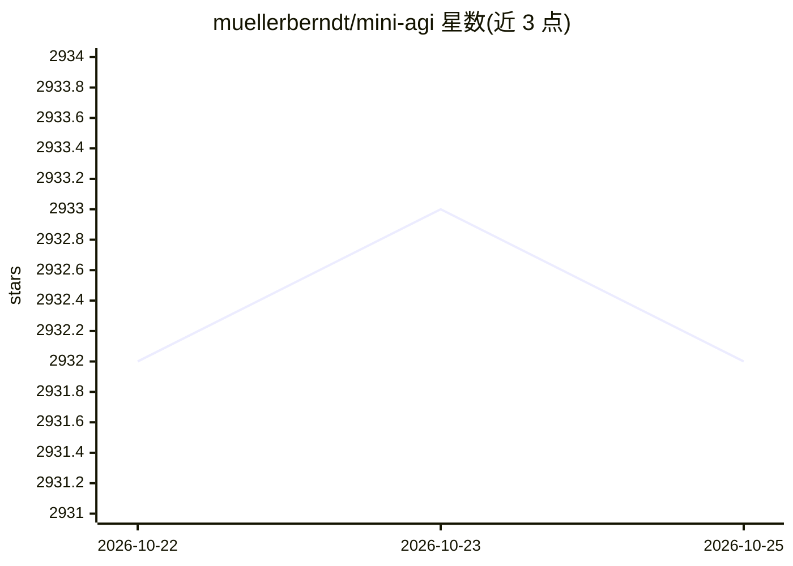

# muellerberndt/mini-agi

⭐ 2,932 · Python · MIT · 推送 2026-10-21 · [GitHub](https://github.com/muellerberndt/mini-agi) · 个人维护

**基于 GPT-3.5/4 API 的极简通用自主 agent**

以 OpenAI API 为后端的命令行自主 agent：结合固定提示、少量工具、思维链与带摘要的短期记忆，支持内心独白与自我批评（critic，可通过环境变量开启）。以目标语句启动，示例覆盖画图、建站、写游戏、渗透测试、订餐等任务。网络搜索默认 DuckDuckGo，可切换 Parallel MCP。需 Python 3.10+，从源码安装运行；README 含安全与隐私提示：agent 可能给出有害命令，且数据会发送至第三方 API。

## 筛选速览

| 维度 | 判定 | 备注 |
|---|---|---|
| AI 角色 | `ai-native` | 本体是模型或模型工具 |
| 许可风险 | `permissive` | MIT |
| 部署形态 | `library` | 以包/库形式分发 |
| 模型依赖 | — | README 未给出锁定关系 |
| 硬件要求 | — | 无带数字的原话,不猜 |
| 安装摩擦 | `low` | 无编译、无系统依赖或容器化 |
| 成熟度 | — | 结构信号不足 |

## 能力要点

- 固定提示+工具集+思维链+带摘要短期记忆的 agent 循环
- 可开启的自我批评（critic）机制以换取准确率
- web_search 支持 DuckDuckGo 与 Parallel MCP 两种提供方
- 命令行式：python miniagi.py <objective> 直接执行目标

## 适用场景

- 用自然语言目标驱动 agent 自主完成画图、建站、写游戏等任务
- 观察与实验自主 agent 的规划-执行-反思循环
- 本地执行渗透测试、数据分析等自动化任务（自担风险）

## 场景标签

`Agent 框架` · 领域:Agent 开发

## 证据(README 行号)

> L3: MiniAGI is a simple autonomous agent compatible with GPT-3.5-Turbo and GPT-4. It combines a robust prompt with a min
> L19: python miniagi.py <objective>

## 星数曲线

2026-10-22 2,932 → 2026-10-25 2,932（+0）

---
*卡片 v1 · prompt 1.4 · 生成 2026-10-21 · 置信度 mid · 依据 README sha `149d7f3c53be` · [字段定义](../../DATASET.md)*
