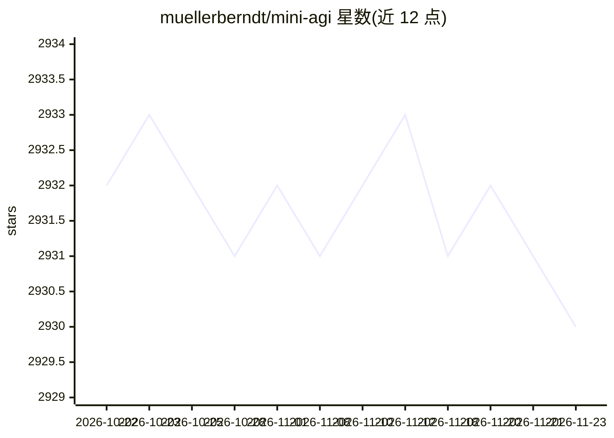

# muellerberndt/mini-agi

⭐ 2,930 · Python · MIT · 推送 2026-11-03 · [GitHub](https://github.com/muellerberndt/mini-agi) · 个人维护

**基于 OpenAI API 的极简通用自主 agent**

以 Python 脚本运行的自主 agent：给定目标后组合提示词、少量工具、思维链与带摘要的短期记忆执行任务，支持内心独白与自我批评，可开启 critic 模式以额外 API 请求换取精度。兼容 GPT-3.5-Turbo 与 GPT-4，Web 搜索默认走 DuckDuckGo，可切换 Parallel 或 Outcrawl 供应商。安装需 git clone 源码并配置 .env 中 OpenAI 密钥，README 附带多组示例，并警示 agent 可能建议有害命令、数据会发送给第三方 API 供应商。

## 筛选速览

| 维度 | 判定 | 备注 |
|---|---|---|
| AI 角色 | `ai-native` | 本体是模型或模型工具 |
| 许可风险 | `permissive` | MIT |
| 部署形态 | `library` | 以包/库形式分发 |
| 模型依赖 | — | README 未给出锁定关系 |
| 硬件要求 | — | 无带数字的原话,不猜 |
| 安装摩擦 | `low` | 无编译、无系统依赖或容器化 |
| 成熟度 | — | 结构信号不足 |

## 能力要点

- 极简工具集+思维链+带摘要的短期记忆的自主执行循环
- 可开启 critic 与内心独白/自我批评机制
- Web 搜索支持 DuckDuckGo（默认）、Parallel、Outcrawl 三种供应商切换
- README 提供画图、建站、渗透测试、游戏开发等约 10 个任务示例

## 适用场景

- 给一个目标让 agent 自主写代码并保存产出文件
- 让 agent 执行信息检索汇总并生成报告/PDF
- 对内网主机做自动化渗透测试与报告生成

## 场景标签

`Agent 框架` `网络安全` · 领域:Agent 开发

## 证据(README 行号)

> L3: MiniAGI is a simple autonomous agent compatible with GPT-3.5-Turbo and GPT-4. It combines a robust prompt with a min
> L19: python miniagi.py <objective>

## 星数曲线

2026-10-22 2,932 → 2026-11-23 2,930（-2）

---
*卡片 v1 · prompt 1.4 · 生成 2026-11-23 · 置信度 high · 依据 README sha `f75b05d37b59` · [字段定义](../../DATASET.md)*
