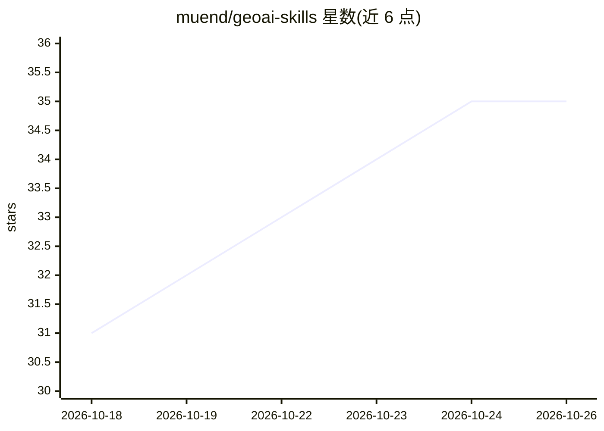

# muend/geoai-skills

⭐ 35 · Python · MIT · 推送 2026-10-17 · [GitHub](https://github.com/muend/geoai-skills) · [官网](https://www.skills.sh/muend/geoai-skills) · 个人维护

**给地理空间 AI agent 的 18 个方法层技能包：判定数据能否支撑结论**

面向 Claude Code、Codex 等 agent 运行时的 18 个地理空间方法技能（SKILL.md 形式，npm 安装）：不替代 GDAL/PostGIS/Earth Engine 等工具，而是在请求与地理结论之间规定前置条件、必跑检查、须报告的证据，以及数据不足时应拒绝作答。配套发布路由基准（167 例，含 held-out 62 例）、92 对配对行为测量与已知缺陷；行为结果为模型评判、未人工核验，作者声明的 Phase 3 质量门未通过并公开了失败记录。各测量限定单一运行时/模型对，不外推。

## 筛选速览

| 维度 | 判定 | 备注 |
|---|---|---|
| AI 角色 | `ai-knowledge` | 知识聚合/清单类 |
| 许可风险 | `permissive` | MIT |
| 部署形态 | `library` | 以包/库形式分发 |
| 模型依赖 | — | README 未给出锁定关系 |
| 硬件要求 | — | 无带数字的原话,不猜 |
| 安装摩擦 | `medium` | 含编译或系统依赖之一 |
| 成熟度 | `idea` | |

## 能力要点

- 18 个窄域专家技能覆盖获取、遥感、深度学习、空间统计等阶段
- 安全失败模式：证据不足时输出更窄结论或拒绝，而非编造数字
- 路由基准 167 例 + 92 对配对行为测量，已知缺陷与失败的质量门公开
- 声明先 CRS/单位/泄漏/不确定性/出处检查，再允许结果成为结论

## 适用场景

- 让地理 AI agent 在数据不支持结论时说明理由并停止
- 遥感变化检测前检查季节、传感器与配准可比性
- 空间 ML 实验中审计空间泄漏并使用分块验证
- 为 GIS 分析 agent 提供方法与验证层护栏

## 场景标签

`数据分析` · 领域:效率与自动化

## 证据(README 行号)

> L9: GeoAI Skills is a vendor-neutral collection of 18
> L11: user request and a geospatial claim. The skills do not replace GDAL, PostGIS,
> L13: which preconditions must hold, which checks must run, what evidence must be

## 星数曲线

2026-10-18 31 → 2026-10-26 35（+4）

---
*卡片 v1 · prompt 1.4 · 生成 2026-10-25 · 置信度 high · 依据 README sha `50f29d9e8cc5` · [字段定义](../../DATASET.md)*
