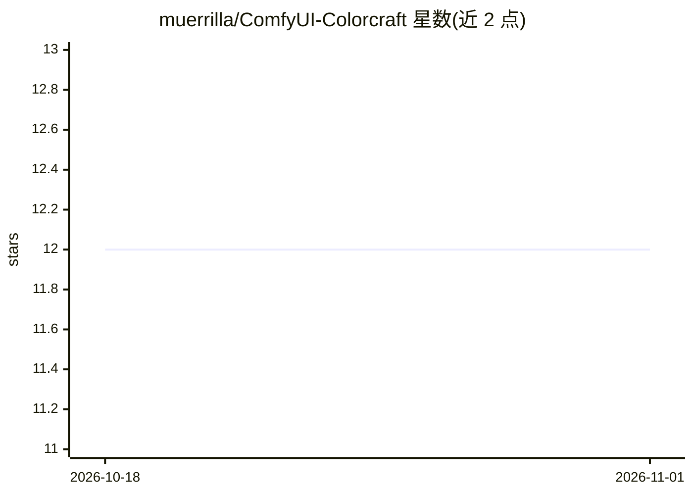

# muerrilla/ComfyUI-Colorcraft

⭐ 12 · Python · MIT · 推送 2026-09-01 · [GitHub](https://github.com/muerrilla/ComfyUI-Colorcraft) · 个人维护

**ComfyUI/Forge Neo 节点包：在潜空间扩散过程中做调色**

为 ComfyUI（自定义节点）与 SD WebUI Forge Neo（扩展面板）提供的调色工具集：通过曝光、对比度、色温/色调、饱和度、色调偏移、分区调色等修饰符，配合调度（Schedule）与亮度/色相范围掩码，在扩散采样过程中直接对 latent 施加向量运算，而非对成品图像做后期处理。除 Basic 节点外，多数节点要求模型 VAE 属于 Qwen Image VAE 或 Flux AE 家族；作者仅在 Krea2 与 Z-Image 上测试，Nodes 2.0 UI 不支持。安装经 ComfyUI Manager、Forge 扩展页或 git clone 完成。

## 筛选速览

| 维度 | 判定 | 备注 |
|---|---|---|
| AI 角色 | `ai-ecosystem` | LLM/agent 周边工具 |
| 许可风险 | `permissive` | MIT |
| 部署形态 | `None` |  |
| 模型依赖 | — | README 未给出锁定关系 |
| 硬件要求 | — | 无带数字的原话,不猜 |
| 安装摩擦 | `low` | 无编译、无系统依赖或容器化 |
| 成熟度 | `idea` | |

## 能力要点

- 在潜空间对生成中图像施加曝光/对比/色温/色调等调整
- 修饰符可挂载调度与亮度/色相范围掩码（可组合 AND/OR/SUB/XOR）
- Forge Neo 版提供 10 个修饰符标签页与 10 个掩码标签页
- 附 workflows/ 示例工作流（基于 Krea2）

## 适用场景

- 在文生图采样过程中直接调整画面曝光与色彩，替代后期调色
- 用范围掩码只调阴影/高光或特定色相区域
- 通过早期步数的编辑引导生成更暗/更亮/更鲜艳的构图

## 场景标签

`图像生成` · 领域:内容生成

## 证据(README 行号)

> L3: ### Color grading for ComfyUI and Forge Neo, applied where it actually matters: inside the diffusion process itself!
> L7: Colorcraft is a set of modular nodes that chain together (ComfyUI) or sequential adjustment layers (Forge Neo), that

## 星数曲线

2026-10-18 12 → 2026-11-01 12（+0）

---
*卡片 v1 · prompt 1.4 · 生成 2026-11-01 · 置信度 high · 依据 README sha `d5cfc6a9957c` · [字段定义](../../DATASET.md)*
