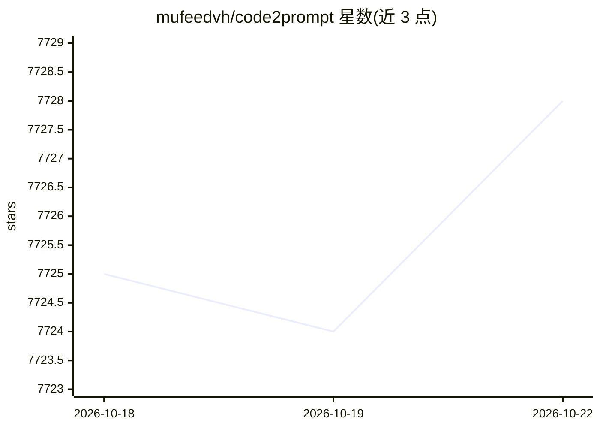

# mufeedvh/code2prompt

⭐ 7,728 · Rust · MIT · 推送 2026-10-16 · [GitHub](https://github.com/mufeedvh/code2prompt) · [官网](https://code2prompt.dev) · 个人维护

**把代码库转成单个 LLM 提示词的 CLI 工具**

Rust 编写的命令行工具，读取代码库并生成带源码树、Handlebars 模板化格式与 token 估算的单一 LLM 提示词。支持 glob 过滤与 .gitignore 规则、CSV/Notebook/JSONL 等格式简化读取、Git diff/log/分支比较注入，并提供 TUI 交互界面。形态包含 Rust 核心库、CLI、Python SDK（pip 可装）与本地 MCP Server，可用于手动复制上下文、构建 AI agent 或作为本地服务供 agent 读取代码库。通过 cargo、Homebrew、pip、二进制发布或源码编译安装，MIT 许可。

## 筛选速览

| 维度 | 判定 | 备注 |
|---|---|---|
| AI 角色 | `ai-ecosystem` | LLM/agent 周边工具 |
| 许可风险 | `permissive` | MIT |
| 部署形态 | `library` | 以包/库形式分发 |
| 模型依赖 | — | README 未给出锁定关系 |
| 硬件要求 | — | 无带数字的原话,不猜 |
| 安装摩擦 | `low` | 无编译、无系统依赖或容器化 |
| 成熟度 | — | 结构信号不足 |

## 能力要点

- 生成含源码树与 Handlebars 模板的 LLM 提示词，带并行 token 估算
- glob 过滤、.gitignore 规则、Git diff/log/分支比较注入
- 生态包含 Rust 核心库、CLI/TUI、Python SDK、MCP Server 四种形态
- 可用 npx skills 为编码 agent 安装 code2prompt 技能

## 适用场景

- 把整个仓库打包成提示词粘贴给 ChatGPT/Claude
- 给编码 agent 提供仓库导航与范围化上下文收集
- 在 RAG 或自动化脚本中用 Python SDK 获取代码库上下文

## 场景标签

`提示工程` · 领域:Agent 开发

## 证据(README 行号)

> L24: **Code2Prompt** is a powerful context engineering tool designed to ingest codebases and format them for Large Langu
> L99: |The internal, high-speed library responsible for secure file traversal, respecting `.gitignore` rules, and structu

## 星数曲线

2026-10-18 7,725 → 2026-10-22 7,728（+3）

---
*卡片 v1 · prompt 1.4 · 生成 2026-10-20 · 置信度 high · 依据 README sha `72018d6f0f08` · [字段定义](../../DATASET.md)*
