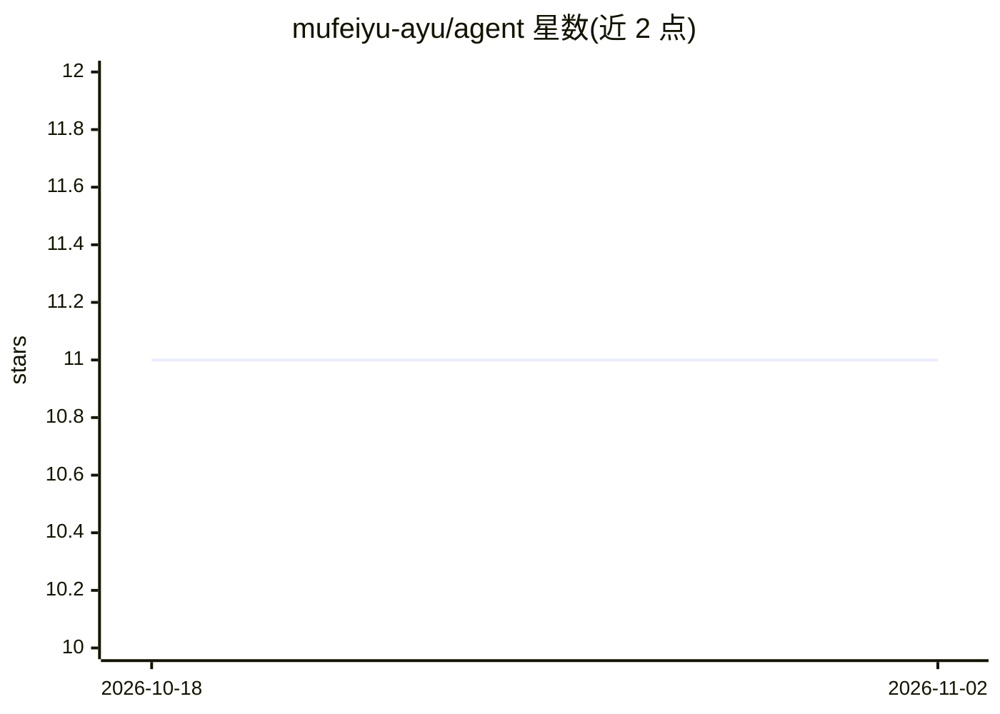

# mufeiyu-ayu/agent

⭐ 11 · TypeScript · MIT · 推送 2026-10-21 · [GitHub](https://github.com/mufeiyu-ayu/agent) · 个人维护 · 中文 README

**TypeScript 服务端 agent 运行时：流式对话、工具调用与引用问答**

用原生 TypeScript 实现的服务端 AI agent 运行时，不依赖 LangChain/LangGraph 等框架，直接实现主循环并处理并发工具调用、token 截断、用户中断、迟到结果覆盖等边界情况。提供 NestJS API、Vue 3 流式聊天前端与管理控制台，支持带引用的知识库检索（RAG）、上下文压缩、按步骤记录运行轨迹。接入 DeepSeek 官方 API 及 OpenAI 兼容中转（GPT/Grok/Gemini）。定位为可阅读、可学习的可运行系统而非安装即用的库，项目文档以中文撰写。

## 筛选速览

| 维度 | 判定 | 备注 |
|---|---|---|
| AI 角色 | `ai-ecosystem` | LLM/agent 周边工具 |
| 许可风险 | `permissive` | MIT |
| 部署形态 | `self-host` | docker 或自建部署 |
| 模型依赖 | locked-api |  |
| 硬件要求 | — | 无带数字的原话,不猜 |
| 安装摩擦 | `low` | 无编译、无系统依赖或容器化 |
| 成熟度 | — | 结构信号不足 |

## 能力要点

- 单次运行单一最终状态：中止、超时、迟到结果竞争提交，单事务落库
- 每步记录（模型调用/工具调用/最终回答）并在管理台展示时间线
- 真实 token 预算的上下文压缩：超限时摘要旧问答而非丢弃
- 支持 DeepSeek 官方 API 与 OpenAI 兼容中转，密钥 AES-256-GCM 加密

## 适用场景

- 自托管一个带知识库检索和引用回答的聊天 agent
- 学习真实失败模式下 agent 循环的实现方式
- 作为自研 agent 运行时的参考实现

## 场景标签

 · 领域:LLM 基础设施/Agent 运行时

## 证据(README 行号)

> L5: A production-minded AI agent runtime in plain TypeScript.
> L80: |`apps/api`|NestJS API: host of the agent runtime (transactions, credentials, product policy), tools, model provide
> L126: Use LangChain, LangGraph, or the Vercel AI SDK when you want to ship quickly and are happy with their abstractions

## 星数曲线

2026-10-18 11 → 2026-11-02 11（+0）

---
*卡片 v1 · prompt 1.4 · 生成 2026-11-02 · 置信度 mid · 依据 README sha `d31df0e7e91a` · [字段定义](../../DATASET.md)*
