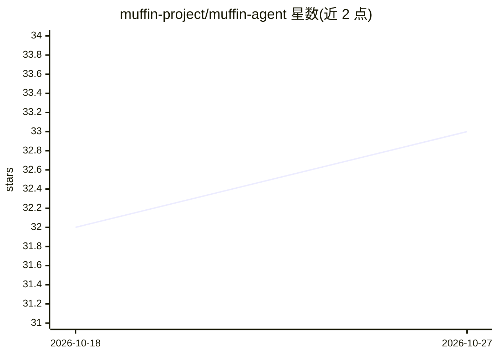

# muffin-project/muffin-agent

⭐ 33 · TypeScript · AGPL-3.0 · 推送 2026-10-23 · [GitHub](https://github.com/muffin-project/muffin-agent) · 个人维护

**单人自托管的个人 AI agent：跨模型与界面保持记忆与授权连续性**

Muffin 是一个 owner-run 的连续个人 agent：将持久信息分为证据、信念、工作、效果、授权五个语义层，使历史、未完成工作与权限边界在对话切换、模型更换、进程重启与多界面（CLI、Telegram，规划中的桌面/语音）之间保持连续。模型与界面均可替换，模型只解释与提议，不自行获得授权；扩展能力按 opt-in 的 package/capability/grant 机制授予。以 TypeScript 编写、自托管，提供 curl 引导安装脚本。当前处于 source-public/pre-alpha，README 明确声明请勿安装用于真实工作，消费者引导尚未就绪。

## 筛选速览

| 维度 | 判定 | 备注 |
|---|---|---|
| AI 角色 | `ai-native` | 本体是模型或模型工具 |
| 许可风险 | `viral` | AGPL-3.0 |
| 部署形态 | `None` |  |
| 模型依赖 | — | README 未给出锁定关系 |
| 硬件要求 | — | 无带数字的原话,不猜 |
| 安装摩擦 | `low` | 无编译、无系统依赖或容器化 |
| 成熟度 | `idea` | |

## 能力要点

- 五语义层架构：evidence / beliefs / work / effects / authority
- 跨模型、跨界面（CLI、Telegram）保持同一 agent 的记忆与授权连续性
- 策略、沙箱与密钥边界：远程模型提供商被作为 egress boundary 对待
- opt-in 扩展机制：package/capability/grant 分离，未安装的能力不存在

## 适用场景

- 作为自托管的长期个人 agent，跨会话延续记忆与未完成工作
- 通过 CLI 与 Telegram 等界面操作同一个 agent 实例
- 在授权边界内让 agent 代为跟进多步骤与长时任务

## 场景标签

`AI 助手` · 领域:对话与助手

## 证据(README 行号)

> L35: It is meant to be one continuous personal agent whose history, unfinished work,
> L45: > **This is already a real system:** Muffin has a resident runtime, CLI, durable
> L146: **Requirements:** a Linux or macOS machine, and a supported model provider.

## 星数曲线

2026-10-18 32 → 2026-10-27 33（+1）

---
*卡片 v1 · prompt 1.4 · 生成 2026-10-26 · 置信度 high · 依据 README sha `d5e19bced571` · [字段定义](../../DATASET.md)*
