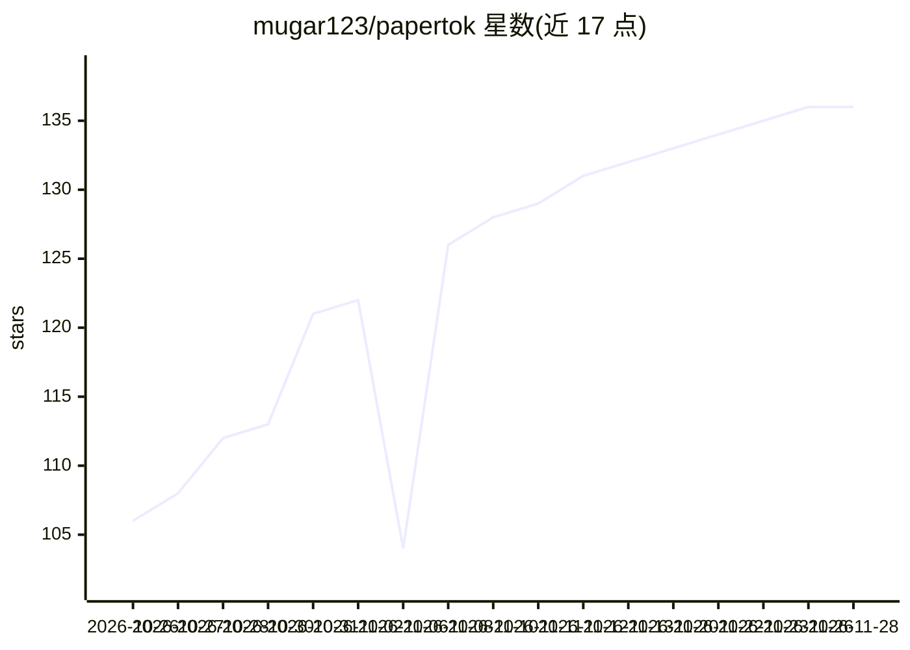

# mugar123/papertok

⭐ 136 · TypeScript · MIT · 推送 2026-11-26 · [GitHub](https://github.com/mugar123/papertok) · [官网](https://papertok.app) · 个人维护

**面向研究者的个性化论文发现信息流应用**

PaperTok 是一个可滚动的个性化科学论文信息流：用户选择领域与主题，应用从 arXiv、OpenAlex、PubMed、OpenReview、Hugging Face 等来源聚合论文记录，结合兴趣、关注与阅读互动生成 For you 推荐，并提供搜索、关注实体、相似论文、引用图谱（可导出 BibTeX）、阅读列表、BibTeX/RIS 导出、每周邮件更新与大学图书馆访问校验。对支持全文的论文提供三个级别的 AI 摘要（Beginner/University/Researcher），AI 内容明确标注且不替代原文；全文不可得或达到用量上限时解释可能不可用。前端 React+Vite，API 为 Cloudflare Worker，认证与用户数据用 Firebase。

## 筛选速览

| 维度 | 判定 | 备注 |
|---|---|---|
| AI 角色 | `ai-enhanced` | 去掉 AI 部分产品仍成立 |
| 许可风险 | `permissive` | MIT |
| 部署形态 | `library` | 以包/库形式分发 |
| 模型依赖 | — | README 未给出锁定关系 |
| 硬件要求 | — | 无带数字的原话,不猜 |
| 安装摩擦 | `medium` | 含编译或系统依赖之一 |
| 成熟度 | — | 结构信号不足 |

## 能力要点

- 聚合 arXiv/OpenAlex/PubMed/OpenReview/Hugging Face 等来源的论文记录
- 三级 AI 摘要（Beginner/University/Researcher）与选段解释，标注为改写且不替代原文
- 引用图谱、相似论文、BibTeX/RIS 导出与公共/私人阅读列表
- 大学邮箱验证后经图书馆路由访问文章

## 适用场景

- 按兴趣刷论文信息流，发现未知的相关工作
- 以不同解释深度阅读跨领域论文
- 管理论文阅读列表并导出参考文献到 Zotero/EndNote/Mendeley
- 经大学图书馆校验获取付费文章访问

## 场景标签

`科研工具` · 领域:学习与行业

## 证据(README 行号)

> L16: PaperTok is a scrollable, personalized feed of scientific papers. Start with a field you
> L78: **Read article → AI summary** opens an AI adaptation of supported full text when
> L163: Requires **Node 22.18 or later**. The frontend uses React and Vite, the API runs on a

## 星数曲线

2026-10-26 106 → 2026-11-28 136（+30）

---
*卡片 v1 · prompt 1.4 · 生成 2026-11-28 · 置信度 high · 依据 README sha `2987653ed312` · [字段定义](../../DATASET.md)*
