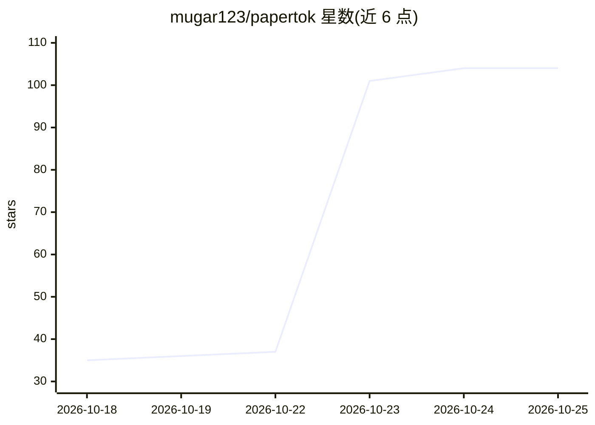

# mugar123/papertok

⭐ 106 · TypeScript · MIT · 推送 2026-10-25 · [GitHub](https://github.com/mugar123/papertok) · [官网](https://papertok.app) · 个人维护

**可滑动的个性化科学论文发现与阅读信息流**

面向科研人员的论文推荐与阅读 Web 应用：从 arXiv、OpenAlex、PubMed、OpenReview、Hugging Face 等来源聚合论文，根据用户的阅读、点赞、收藏、跳过与关注行为调整推荐。支持论文/作者/机构/项目检索、引用图谱、BibTeX 导出、大学图书馆邮箱验证接入付费论文，以及将全文改写为 Beginner/University/Researcher 三级难度并附 AI 披露的 PDF/LaTeX 导出。本地运行需 Node 22+，配合 Cloudflare Worker 与 Firebase；项目声明处于活跃开发中。

## 筛选速览

| 维度 | 判定 | 备注 |
|---|---|---|
| AI 角色 | `ai-native` | 本体是模型或模型工具 |
| 许可风险 | `permissive` | MIT |
| 部署形态 | `library` | 以包/库形式分发 |
| 模型依赖 | — | README 未给出锁定关系 |
| 硬件要求 | — | 无带数字的原话,不猜 |
| 安装摩擦 | `medium` | 含编译或系统依赖之一 |
| 成熟度 | — | 结构信号不足 |

## 能力要点

- 聚合 arXiv/OpenAlex/PubMed/OpenReview/Hugging Face 等来源的个性化推荐流
- 全文按三级难度改写为通俗语言，输出附 AI 披露的 PDF/LaTeX 导出
- 大学邮箱验证接入机构图书馆的付费论文访问
- 支持论文/作者/主题/机构/资助项目检索与引用图谱、BibTeX 导出

## 适用场景

- 不知道搜什么关键词时刷信息流发现相关领域论文
- 把难读的论文改写成适合自己水平的通俗版本并做笔记
- 通过机构图书馆权限打开付费论文

## 场景标签

`推荐系统` `科研工具` · 领域:学习与行业

## 证据(README 行号)

> L16: PaperTok helps you find research when you don't know what to search for. Pick your fields,
> L34:  specialist sources. Likes, saves, skips and reading time shape your recommendations.
> L45: - **Read in plain words** at Beginner, University or Researcher level when supported full

## 星数曲线

2026-10-18 35 → 2026-10-25 104（+69）

---
*卡片 v1 · prompt 1.4 · 生成 2026-10-23 · 置信度 mid · 依据 README sha `9e4d14bf4651` · [字段定义](../../DATASET.md)*
