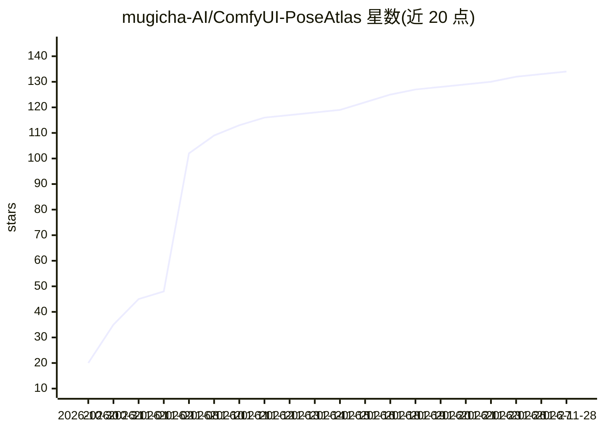

# mugicha-AI/ComfyUI-PoseAtlas

⭐ 134 · Python · NOASSERTION · 推送 2026-11-04 · [GitHub](https://github.com/mugicha-AI/ComfyUI-PoseAtlas) · 个人维护 · 中文 README

**把 PoseAtlas 参考图集做成 ComfyUI 图库节点**

将 RuiC-PoseAtlas 的姿势、服饰、肖像三套静态参考图集接入 ComfyUI：共 4,345 条条目（288 组姿态 × 5 角度等），通过可视化图库面板按分类或三语关键词选择，节点输出 IMAGE/MASK，可接入 ControlNet、图生图与编辑模型。仓库不含任何图片，安装后需运行下载脚本从公开源站取回；深度原图因源站禁止批量抓取，只能逐张按需下载。面向 AI 绘画创作者。

## 筛选速览

| 维度 | 判定 | 备注 |
|---|---|---|
| AI 角色 | `ai-knowledge` | 知识聚合/清单类 |
| 许可风险 | `none` | NOASSERTION |
| 部署形态 | `None` |  |
| 模型依赖 | — | README 未给出锁定关系 |
| 硬件要求 | — | 无带数字的原话,不猜 |
| 安装摩擦 | `low` | 无编译、无系统依赖或容器化 |
| 成熟度 | — | 结构信号不足 |

## 能力要点

- 姿势 1,439 / 服饰 1,407 / 肖像 1,499 共 4,345 条参考图，支持中英日三语搜索与界面
- 提供线稿与灰度深度两种渲染，深度模式保留双人前后遮挡关系
- 节点输出 IMAGE/MASK，附 8 个示例工作流（ControlNet、换装、角色一致性等）
- 图片不打包不分发，提供带镜像切换与断点续传的下载脚本

## 适用场景

- 为 ControlNet 姿态控制挑选多角度人台线稿或深度图
- 用服饰集做换装与服装风格迁移的参考图
- 用肖像集做角色一致性与发型参考
- 在 ComfyUI 图库里按三语关键词快速检索姿势参考

## 场景标签

`图像生成` · 领域:内容生成

## 证据(README 行号)

> L5: 把 RuiC-PoseAtlas 的**三套图集**做成 ComfyUI 节点：
> L15: > ⚠️ **本仓库不含任何图片**——连缩略图也不带，一张都没有。
> L36: RuiC-PoseAtlas 本身是一个静态参考图库。本项目把它的浏览体验搬进 ComfyUI：
> L266: 这个节点本身很轻（只读图，不跑模型），但配套的 ControlNet / 编辑模型需要显存。

## 星数曲线

2026-10-30 20 → 2026-11-28 134（+114）

---
*卡片 v1 · prompt 1.4 · 生成 2026-11-28 · 置信度 high · 依据 README sha `af44d7ff9c40` · [字段定义](../../DATASET.md)*
