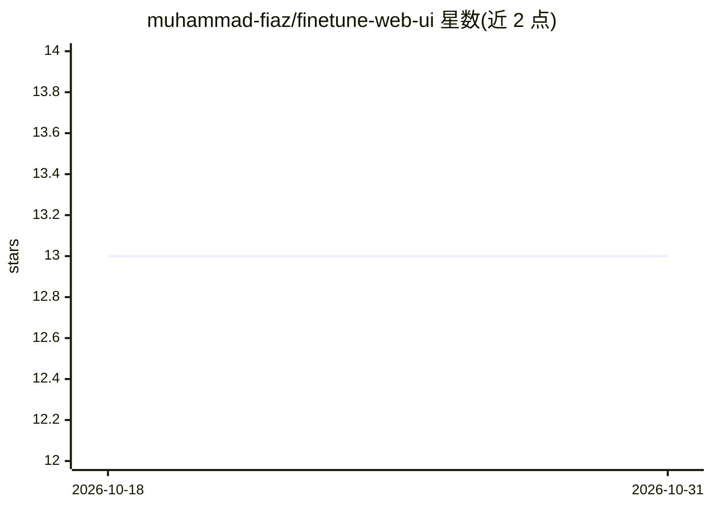

# muhammad-fiaz/finetune-web-ui

⭐ 13 · Python · AGPL-3.0 · 推送 2026-03-03 · [GitHub](https://github.com/muhammad-fiaz/finetune-web-ui) · 个人维护

**面向 LLM 微调训练与部署的 Web 图形界面**

为 Llama、GPT 等预训练模型提供微调训练与部署的 Web UI：用户通过界面上传数据集（URL 或本地文件）、选择预训练模型、配置学习率/批大小等超参数、实时监控训练进度，并在训练完成后从界面直接部署推理。基于 Python 实现，用 Poetry/UV 管理依赖，运行 launch.py 启动，默认监听 localhost:7860。README 声明项目仍在开发中、尚未可用于生产环境，且仅供研究与教育用途。功能列表中的多数能力标注为计划中特性。

## 筛选速览

| 维度 | 判定 | 备注 |
|---|---|---|
| AI 角色 | `ai-ecosystem` | LLM/agent 周边工具 |
| 许可风险 | `viral` | AGPL-3.0 |
| 部署形态 | `library` | 以包/库形式分发 |
| 模型依赖 | — | README 未给出锁定关系 |
| 硬件要求 | — | 无带数字的原话,不猜 |
| 安装摩擦 | `low` | 无编译、无系统依赖或容器化 |
| 成熟度 | `idea` | |

## 能力要点

- Web 界面完成数据集上传、模型选择与超参数配置
- 训练进度实时监控与训后直接部署推理
- 支持 Llama、GPT 等预训练模型微调
- 声明跨平台（Windows/macOS/Linux）与可云端部署

## 适用场景

- 不想写脚本，通过网页界面微调 Llama/GPT 等模型
- 统一管理数据集、训练配置与微调后的模型
- 训练完成后直接在同一界面部署推理

## 场景标签

`微调` · 领域:训练与推理

## 证据(README 行号)

> L5: **Finetune Web UI** is a user-friendly interface for training and deploying machine learning models, specifically de
> L15: - **Simplified deployment:** Once the model is fine-tuned, deploy it instantly for inference.

## 星数曲线

2026-10-18 13 → 2026-10-31 13（+0）

---
*卡片 v1 · prompt 1.4 · 生成 2026-10-31 · 置信度 low · 依据 README sha `f3520ecee982` · [字段定义](../../DATASET.md)*
