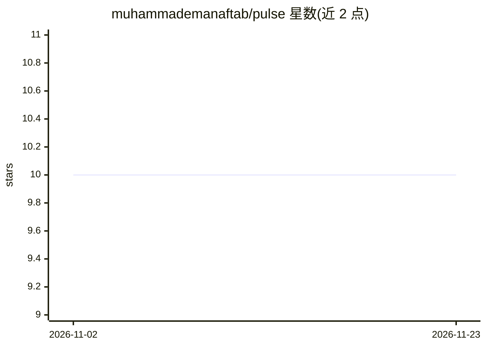

# muhammademanaftab/pulse

⭐ 10 · Python · MIT · 推送 2026-11-19 · [GitHub](https://github.com/muhammademanaftab/pulse) · 个人维护

**给 Claude Code 用户自动记录会话并生成每日笔记的记忆层**

面向 Claude Code 用户的会话记忆工具：通过 hook 自动捕获每次会话存入用户自有的 Convex 数据库，夜间以 claude.ai routine 生成分项目整理的每日笔记，写入用户自己的 git 仓库，可在 Obsidian 打开。在此笔记基础上提供周回顾、项目页、Recall 问答、社交帖草稿与站会草稿等技能。数据存储与笔记仓库均归用户所有，无 Pulse 服务端。需 Claude Code、Python 3.9+、Node.js 20+ 与免费 Convex 账户，当前处于 0.x 早期阶段。

## 筛选速览

| 维度 | 判定 | 备注 |
|---|---|---|
| AI 角色 | `ai-ecosystem` | LLM/agent 周边工具 |
| 许可风险 | `permissive` | MIT |
| 部署形态 | `library` | 以包/库形式分发 |
| 模型依赖 | — | README 未给出锁定关系 |
| 硬件要求 | — | 无带数字的原话,不猜 |
| 安装摩擦 | `low` | 无编译、无系统依赖或容器化 |
| 成熟度 | `idea` | |

## 能力要点

- 通过 Claude Code hook 自动捕获每次会话到用户自有 Convex 数据库
- 夜间自动生成分项目整理的每日/每周笔记，写入用户 git 仓库
- Recall 技能支持按日期与出处回溯历史工作记录
- 卸载前备份 settings.json，保留用户凭证与笔记仓库

## 适用场景

- 自动积累开发日志，回顾一段时间内完成了什么
- 在多个项目间查询过去的修复记录与决策原因
- 从一周工作笔记生成站会汇报或社交帖草稿

## 场景标签

`知识库管理` `Agent 记忆` · 领域:Agent 开发

## 证据(README 行号)

> L11: Pulse fixes that. It records every Claude Code session to a database you own, and each night it writes up your day,
> L63: - Claude Code
> L154: Pulse is early (0.x). Capture, the daily note, project pages, the weekly recap, recall, the standup and post draft

## 星数曲线

2026-11-02 10 → 2026-11-23 10（+0）

---
*卡片 v1 · prompt 1.4 · 生成 2026-11-19 · 置信度 mid · 依据 README sha `3a39345bee07` · [字段定义](../../DATASET.md)*
