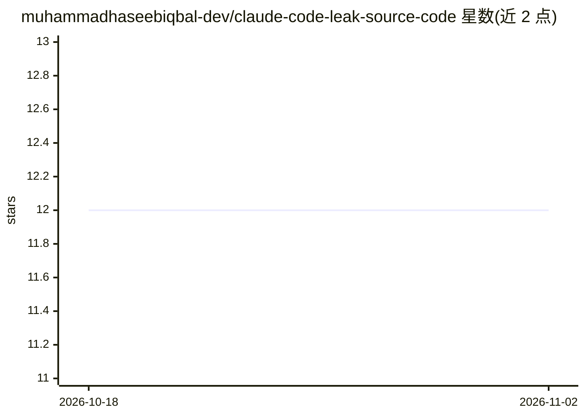

# muhammadhaseebiqbal-dev/claude-code-leak-source-code

⭐ 12 · TypeScript · NOASSERTION · 推送 2026-04-03 · [GitHub](https://github.com/muhammadhaseebiqbal-dev/claude-code-leak-source-code) · [官网](https://github.com/muhammadhaseebiqbal-dev/claude-code-leak-source-code) · 个人维护

**Claude Code 泄露源码快照镜像，附 MCP 浏览服务器**

镜像 2026-03-31 经 npm 源码映射文件暴露的 Anthropic Claude Code 未编译 TypeScript 源码（约 1,900 文件、51.2 万行），raw 快照保存于 backup 分支，main 分支新增文档与工具。README 记录其架构：React/Ink 终端 UI、Bun 运行时、约 40 个工具与 85 个斜杠命令、子代理/团队系统、IDE 桥接层。仓库附带 claude-code-explorer-mcp 服务器，供 MCP 客户端交互式检索源码（读文件、grep、工具目录）。注意：这是对泄露产物的第三方整理，非官方仓库。

## 筛选速览

| 维度 | 判定 | 备注 |
|---|---|---|
| AI 角色 | `ai-knowledge` | 知识聚合/清单类 |
| 许可风险 | `none` | NOASSERTION |
| 部署形态 | `library` | 以包/库形式分发 |
| 模型依赖 | — | README 未给出锁定关系 |
| 硬件要求 | — | 无带数字的原话,不猜 |
| 安装摩擦 | `low` | 无编译、无系统依赖或容器化 |
| 成熟度 | — | 结构信号不足 |

## 能力要点

- 保存 512,000+ 行 Claude Code TypeScript 源码快照
- 附带 claude-code-explorer-mcp 服务器：列出/读取/grep 源码与架构导览
- 配套文档目录覆盖架构、工具、命令与子系统指南

## 适用场景

- 研究 Claude Code 的工具系统、多代理与权限架构实现
- 通过 MCP 客户端交互式浏览与检索源码快照
- 了解 React/Ink + Bun 构建终端 AI 应用的方式

## 场景标签

 · 领域:LLM 工具/源码研究

## 证据(README 行号)

> L3: **An exploratory mirror of a source snapshot reportedly exposed via published source maps on March 31, 2026**
> L75: This repo also ships an MCP server that lets any MCP-compatible client (Claude Code, Claude Desktop, VS Code Copilo

## 星数曲线

2026-10-18 12 → 2026-11-02 12（+0）

---
*卡片 v1 · prompt 1.4 · 生成 2026-11-01 · 置信度 high · 依据 README sha `3a97bebfaaf5` · [字段定义](../../DATASET.md)*
